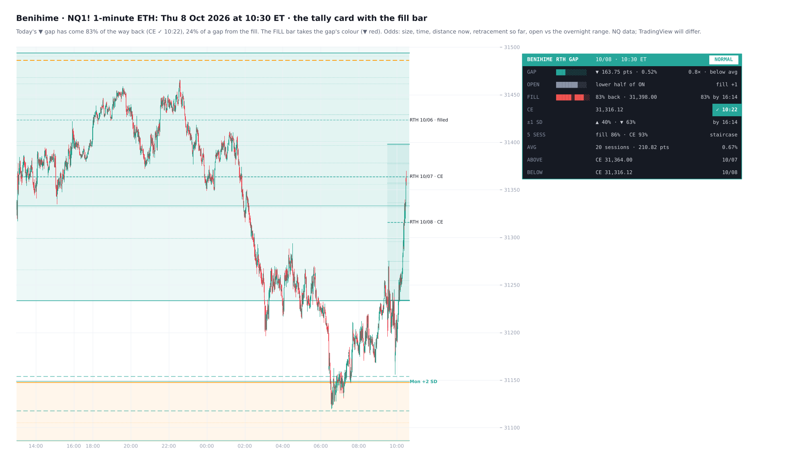
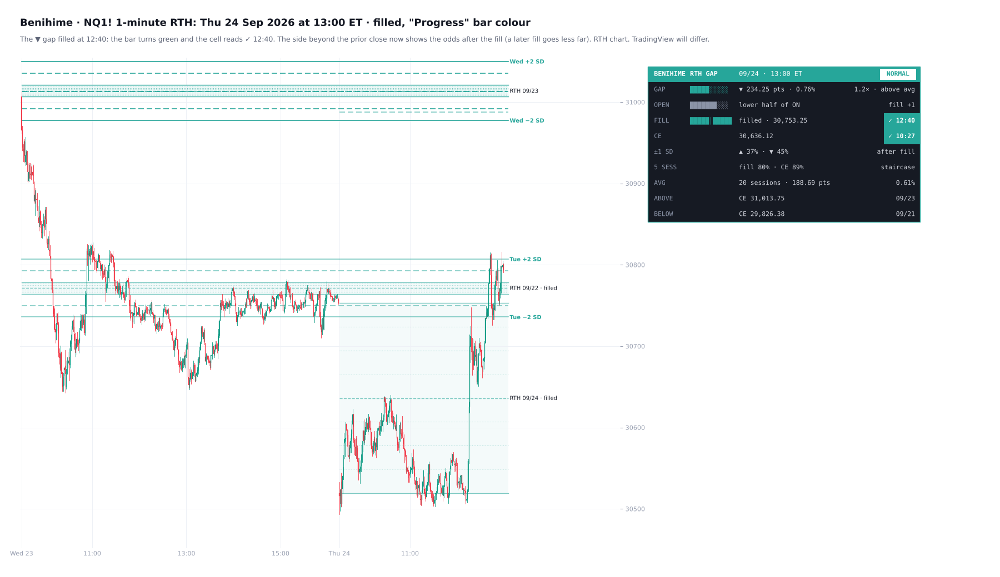
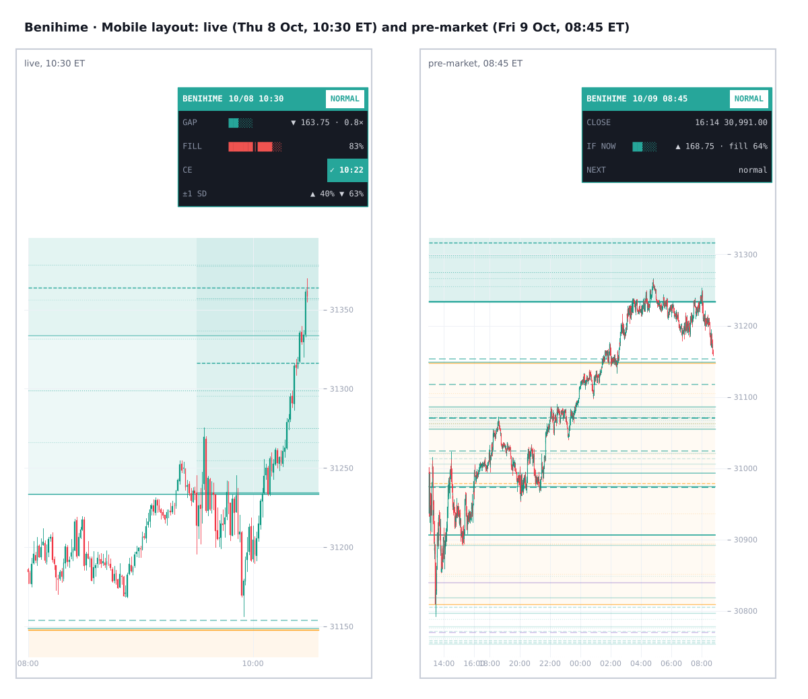

# Benihime v2

**RTH gap map for NQ, ES and RTY, with a tally card, a live fill bar and live fill odds**

TradingView indicator, Pine Script v6. Open source under the Mozilla Public License 2.0. *Not yet published on TradingView.*

v1 is in [unclehk2000/benihime](https://github.com/unclehk2000/benihime). v2 adds the tally card with the FILL bar, live fill and CE odds (distance now, retracement so far, the open's place in the overnight range), the Mobile layout and alerts. Confluence zones were tested and not built.

Files: `Benihime_RTH_Gaps.pine` (the v2 script), `TradingView_description.txt` (publication text), `research/` (the v2 tests and build scripts; no market data included).

*Mock-ups from 1-minute data; TradingView rendering will differ.*

**Benihime** maps RTH gaps the way NWOGs are mapped. An RTH gap is the overnight move between two regular sessions: from the prior RTH close (the 16:14 bar, the 16:15 ET close) to the next 09:30 ET open.
- Every gap of the last 20 sessions (up to 60) runs right in price.
- The last five get a closer look: octants, plus steps one and two gap sizes beyond them.
- A tally-style card tracks today's gap against the average RTH gap. Its **FILL bar** fills as price trades back toward the prior close.
- **Live odds** for the fill and the CE follow the gap's size, the time, how far price is from the fill now, how far it has already come back, and where the open sat in the overnight range. They are measured on **6,169 gaps** on NQ, ES and RTY (2018–26) and checked out of sample.
- **Desktop and Mobile** layouts, and alerts.
- Release days (CPI, NFP, PPI, GDP, PCE, retail sales) switch the day's regime.

*It is a map of where the RTH gaps sit and how gaps of each size usually behave, not a signal generator.*

## What it draws on price

- **Every RTH gap** of the last N sessions (default 20, up to 60): its edges (the prior close and the open) and its **CE** (consequent encroachment, the 50%). Each one starts at its own 09:30 open and runs to the right of price.
- **The staircase, the last 5 sessions (rolling):** each gap is split into **octants**. The CE is dashed, the quarters dotted and the eighths faint.
- Each staircase gap also gets **±1 SD** (dashed) and **±2 SD** (solid): one and two gap sizes above its top and below its bottom. Five gaps stepping through the week build a staircase of levels. Staircase gaps are shaded.
- **Each ±2 SD line carries its gap's weekday** at the right end, e.g. *Tue +2 SD* or *Wed CPI −2 SD*, so every step can be traced to the day it came from.
- **Release days keep their staircase** (±1 / ±2 SD and the labels) for as long as they stay on the chart, not only while they are one of the last five. Their labels then add the date.
- **Sessions 6 to N** (default 10): quarters only (25%, CE, 75%).
- **Older gaps:** edges and CE only.
- **Filled gaps fade.** The labels on the right give the date, the release tag, and *CE* or *filled*. Labels at nearly the same price share one, so they never print over each other. Hover a label for the prior close, the open, the size against the average, when the CE and the fill were reached, and the ±1 SD prices.

## Release regime

- **Major releases, CPI and NFP** (orange): the release calendars Gran Rey Cero and Desgarrón use.
- **Other 08:30 releases** (purple):
  - **PPI** (BLS);
  - **GDP** and **PCE** / personal income and outlays (BEA);
  - **retail sales** (Census).
- **Your own dates** are tagged *NEWS* in the purple colour.
- The dates are the actual release days, including the shutdown moves, taken from the agencies' archives and ALFRED. CPI, NFP and PPI are loaded to Dec 2027; GDP, PCE and retail sales to Dec 2026.

**What the tests showed** (NQ, ES and RTY, 2018–26):
- **CPI and NFP gaps run 1.4–1.5× the size of normal-day gaps** (p < 0.001, in both periods and on every symbol). 35–40% of them are over 1.5× the 20-session average, against 21% of normal-day gaps.
- **The other releases move price at 08:30**: their 08:30–08:34 range runs 1.8–3.6× a normal day's, in every period and on every symbol. *Their RTH gaps were not reliably bigger* (PPI 1.14×, GDP 1.20×, retail sales 1.18×, PCE 1.00×; none held in both periods).
- **For its size, a release-day gap behaves like any other gap.** No fill or CE odds differed once size was accounted for. *The regime tells you how big the gap is likely to be; the odds come from its size.*

## Card · today's gap against the average

Four columns: the row, a bar, the value, the result. A row that has happened turns into a green **✓** cell with the time.

**During RTH:**
- **GAP:** points and %. The bar shows the size against the 20-session average (full at 2.5×):
  - *small* (under 0.5×);
  - *below avg* (0.5–1×);
  - *above avg* (1–1.5×);
  - *large* (1.5–2.5×);
  - *very large* (2.5× and over).
- **OPEN:** where the 09:30 open sat in the overnight range (18:00–09:29 ET), toward the gap's side. The result shows how much that moves the fill odds against an average open.
- **FILL:** the bar fills as price trades back from the open toward the prior close; the mark in the middle is the CE. It shows how much of the gap has come back so far, and the odds of a fill by 16:14 now. Once filled: **✓** and the time.
- **CE:** the midpoint, and the odds of reaching it by 16:14 now, or **✓** and the time.
- **±1 SD:** the odds of each side by 16:14, or the time it was reached. Once the gap fills, the side beyond the prior close shows its odds *after the fill*.
- **5 SESS:** the odds of a fill, and of reaching the CE, while the gap is still one of the last five.
- **AVG:** the average gap over N sessions (default 20). Every day counts, Mondays included. If fewer are loaded, the card says how many.
- **ABOVE** and **BELOW:** the CE and date of the nearest unfilled gap on each side of price.
- The header shows the day's releases, or *NORMAL*.

**Outside RTH:**
- the 16:14 close;
- *if it opened now*: the gap's size (bar), where it would sit in the overnight range so far, and its fill odds;
- the coming session's releases;
- the last gap's result.

**The FILL bar's colour** (View settings):
- *Gap direction:* green for a gap up, red for a gap down;
- *Progress:* red until the gap fills, then green.

**Mobile** shows one narrow card: GAP, FILL, CE and ±1 SD (outside RTH: the close, if it opened now, and the next session). Every row keeps its full explanation in the tooltip.

## Alerts

Create one alert on the indicator with *Any alert() function call*. Each fires once, on the bar it happens, with the numbers in the message:
- **new gap at 09:30:** size against the average, the release tag, and the fill odds;
- **CE reached:** the time, and the fill odds at that moment;
- **filled:** the time, and the odds of −1 SD by 16:14 after the fill;
- **±1 SD reached** (off by default).

## What the tests showed

Reached during RTH (09:30–16:14), by size against the 20-session average:

**Fill**
- under 0.5×: **88%**;
- 0.5–1×: 64%;
- 1–1.5×: 49%;
- 1.5–2.5×: 38%;
- 2.5× and over: **22%**.

**CE**
- under 0.5×: **94%**;
- 0.5–1×: 82%;
- 1–1.5×: 69%;
- 1.5–2.5×: 63%;
- 2.5× and over: **49%**.

These held in 2018–24 and in 2025–26, and on each of NQ, ES and RTY, to within about 4 points.

**All gaps**
- CE 78% and fill 62% in RTH.
- Within 5 sessions: 91% and 84%. Within 20 sessions: 96% and 92%.

**By time of day**
- About 36% have filled by 10:00, 48% by 11:00 and 53% by 12:00.
- An unfilled gap's odds shrink as the day goes on. For example, a 1–1.5× gap not yet filled at 10:30 went on to fill by 16:14 on 32% of days.

**The staircase's SDs** (while the gap is one of the last five):
- beyond the open (the gap's direction): +1 SD 84%, +2 SD 71%;
- beyond the prior close: 71% and 60%.

**Live odds**
- From 09:30, the fill and CE odds update with:
  - the gap's size;
  - the time;
  - how far price is from the fill (or the CE) now;
  - how far it has already come back (fill only);
  - where the open sat in the overnight range.
- Fitted on 2018–24 and scored on 2025–26, they cut the error of the size-and-time table by about 12%.
- **The overnight range:** for the same size, an open at the overnight extreme on the gap's side fills less often, and one back inside the range more often. By open location (back inside / the gap's half / at the extreme):
  - 0.5–1× gaps: 71%, 65%, 59%;
  - 1–1.5× gaps: 59%, 49%, 45%.
  This held in 2018–24 and in 2025–26, and on each of NQ, ES and RTY.
- **After the fill**, the odds of −1 SD (one gap beyond the prior close) by 16:14 depend on how early it filled. For example, a 1× gap reached it 66% of the time when it filled in its first 5 minutes, and 43% when it filled after 2½ hours.

**What did not help** (tested on the same gaps, size held fixed):
- the dollar: DXY's overnight move with or against the gap (2023–26);
- the open beyond the prior day's high or low (it did not hold in 2025–26 on its own);
- the prior session's direction or where it closed in its range;
- Mondays;
- **stacked staircase levels:** where levels from different gaps sit within a tenth of the average gap, price held no more often than at a single level. That is why the card does not mark confluence zones.

**After the staircase**
- A gap still unfilled after 5 sessions filled within the next 15 sessions 49% of the time.
- One whose CE was still untouched reached it 52% of the time.

## Settings

**View** sits at the top, the same as in my other indicators:
- card theme;
- layout: Desktop or Mobile;
- the FILL bar's colour: by gap direction or by progress, and the two colours;
- text size;
- chart text colour (the card keeps its own);
- gap labels (last 5, all or off);
- label date format;
- card on/off and position.

**RTH gaps:**
- keep last;
- quarters until (sessions old);
- average over;
- normal-day colour;
- shading;
- how far the lines run past the last bar;
- skip tiny gaps.

**Staircase:**
- octants;
- ±1 SD and ±2 SD;
- SD line width, and the ±1 SD style (±2 SD are solid);
- SD colour, or the gap's own;
- weekday labels on the ±2 SD;
- whether release days keep their staircase.

**Release regime:** CPI, NFP, PPI, GDP, PCE and retail sales, each on or off; the two release colours; your own dates.

**Alerts:** new gap, CE, fill and ±1 SD, each on or off.

## How to use

- Built for CME index futures: **NQ / MNQ**, **ES / MES** and **RTY / M2K** (YM works the same way).
- Use a continuous, back-adjusted chart (*B-ADJ*) so roll days do not show as gaps.
- **ETH or RTH charts:** the gaps are the same on both.
  - On an *ETH* chart, overnight trading counts toward the CE and the fill.
  - On an *RTH* chart only regular-hours trading counts, and each gap is the visible jump from one session's 16:14 candle to the next 09:30 candle.
- Use a chart of 15 minutes or less. The gaps are read from 15-minute bars of the chart's own symbol, so each gap needs its days loaded.
- **On a 1-minute ETH chart**, only a week or two may be loaded. Scroll left to load more, or use an RTH chart or a 3, 5 or 15-minute chart for 20+ sessions. The card's AVG row shows how many gaps are loaded.

## Data and method

- NQ, ES and RTY front-month 1-minute data, Jan 2018 – Oct 2026.
- 6,169 RTH gaps: each from the prior 16:14 close to the 09:30 open, on the same contract. Early closes and roll days are left out.
- **Size** = |gap| ÷ the mean |gap| of the previous 20 sessions. The card's size tag and odds always use this 20-session average, whatever average you choose to display.
- **Fill** = price trades back to the prior close. **CE** = the gap's midpoint. **k SD** = k gap sizes beyond the gap's top or bottom.
- **The live odds:** logistic models on every unfilled gap at 0, 15, 30, 45, 60, 90, 120, 180, 240, 300 and 360 minutes after the open, read between those checkpoints. Each term held pooled (p < 0.05, errors clustered by date), in 2018–24 and 2025–26, and on each symbol.
- **The overnight range** is read from 15-minute bars of the extended session, so it is the same on ETH and RTH charts.
- **The release tests:**
  - gap size: a regression on log size, with errors clustered by date;
  - behaviour for its size: a logistic model on size;
  - both checked on each period and each symbol.
- **On the chart:**
  - gaps come from 15-minute bars: the 16:00 bar's close is the 16:14 close, and the 09:30 bar's open is the open;
  - each finished 15-minute bar is checked against every open gap;
  - today's gap is checked minute by minute on the chart;
  - only finished bars and the current bar's open are used, so nothing sees future data.
- Release dates need updating once a year.

## Limitations

*These are historical frequencies, not guarantees.*
- The odds were measured on NQ, ES and RTY. Other symbols show the same tables without a test of their own.
- For gaps before today, the CE and fill times are to the 15-minute bar.
- Nothing here is financial advice.

## Why the name

**Benihime**, the *Crimson Princess*, is Kisuke Urahara's zanpakutō. Her Bankai, *Kannonbiraki Benihime Aratame*, restructures whatever it touches. This indicator does the same to the RTH gaps: it takes each one apart into octants and steps, and lays the whole set out at once.

## Credits

- ICT concepts (*Michael J. Huddleston*): the RTH or opening range gap, consequent encroachment, gap quarters, and mapping opening gaps forward in price, as with the NWOG.
- The layout follows my OpenGaps · NWOG / NDOG, a Pine v6 rework of *fadizeidan*'s ICT NWOG/NDOG.
- Release dates come from the BLS, BEA and Census release archives, and ALFRED (Federal Reserve Bank of St. Louis). The CPI and NFP calendars are shared with Gran Rey Cero and Desgarrón.
- Written from scratch; open source under MPL 2.0.
