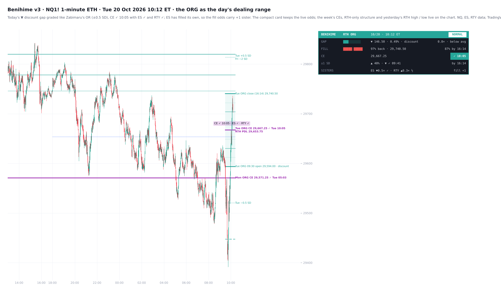
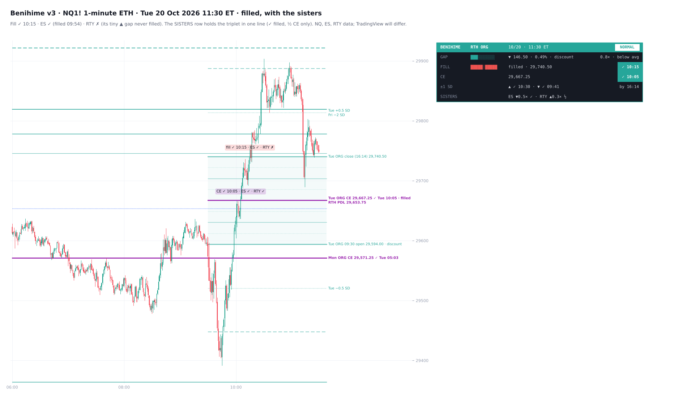
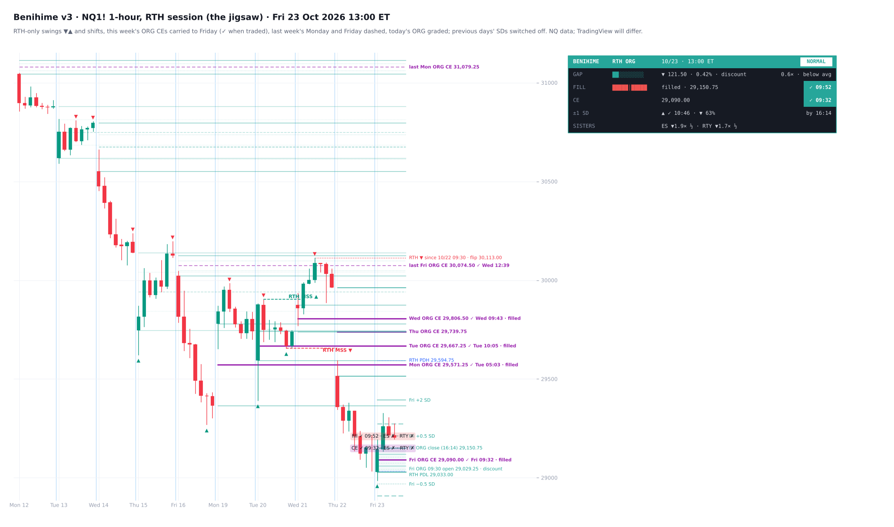
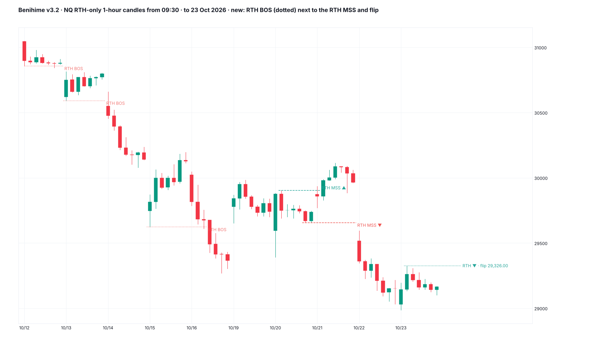

# Benihime v3

**The RTH opening range gap (ORG) as the day's dealing range, the week's ORG CEs, RTH-only structure and the NQ / ES / RTY triplet, on top of the RTH gap map**

TradingView indicator, Pine Script v6. Open source under the Mozilla Public License 2.0. *Not yet published on TradingView.*

v1 is in [unclehk2000/benihime](https://github.com/unclehk2000/benihime) and v2 in [benihime-v2](../benihime-v2). v3 makes the chart structure-first, the way Zabimaru treats the opening range, and blends in what ICT teaches about the RTH ORG. Every lecture claim was run through a HYDRA pass first ([below](#the-lecture-claims-a-hydra-pass)).

Files: `Benihime_RTH_Gaps.pine` (the v3 script), `TradingView_description.txt` (publication text), `research/` (the v3 tests, model refit and mock-up scripts; v2's are in [benihime-v2/research](../benihime-v2/research); no market data included).

*Tue 20 Oct 2026, 10:12. Today's discount gap is graded like Zabimaru's opening range. Its CE traded at 10:05 with ES ✓ and RTY ✓. ES has already filled its own gap, so the fill odds carry one sister. This week's ORG CEs are purple.*

*The same week on a 1-hour RTH chart. It shows RTH-only swings and shifts and the week's CEs carried to Friday, with last week's Monday and Friday dashed.*

*Mock-ups from 1-minute data; TradingView rendering will differ.*

**Benihime** maps RTH gaps the way NWOGs are mapped. An RTH gap is the overnight move between two regular sessions: from the prior RTH close (the 16:14 bar, the 16:15 ET close) to the next 09:30 ET open.
- **Today's gap is the day's dealing range**, graded like Zabimaru's opening range: bold edges and CE, solid quarters, dotted eighths and ±0.5 SD. Labels mark the candle where the CE and the fill traded, with each sister's ✓ / ✗.
- **This week's ORG CEs** are named by weekday and carried to Friday, with last week's Monday and Friday dashed, as ICT does.
- **RTH-only structure** comes from 1-hour candles of the regular session, whatever the chart's session: swings, shifts, the flip level, and yesterday's RTH high and low.
- **The triplet:** NQ, ES and RTY's own gaps side by side. Sisters that have already filled add to the fill odds.
- Every gap of the last 10 sessions (up to 60) runs right in price. The last five get steps one and two gap sizes beyond them.
- A tally-style card tracks today's gap against the average RTH gap. Its **FILL bar** fills as price trades back toward the prior close.
- **Live odds** for the fill and the CE (and ICT's CE by 10:00) follow the gap's size, the time, how far price is from the fill now, how far it has already come back, and where the open sat in the overnight range. They are measured on **6,169 gaps** on NQ, ES and RTY (2018–26) and checked out of sample.
- **Desktop and Mobile** layouts, and alerts.
- Release days (CPI, NFP, PPI, GDP, PCE, retail sales) switch the day's regime.

*It is a map of where the RTH gaps sit and how gaps of each size usually behave, not a signal generator.*

## Today's ORG · the dealing range

ICT treats the RTH ORG (the prior 16:14 close to the 09:30 open) as a ready-made range for the day. He grades it in quadrants and octants, calls the CE the "half gap", and looks for PD arrays on its levels.
- **The grid**, drawn the way Zabimaru draws the opening range:
  - the 09:30 open and the prior 16:14 close as bold edges, named *premium* (a gap up) or *discount* (a gap down) as ICT does;
  - the CE in bold;
  - the quarters solid and the eighths dotted;
  - ±0.5 SD, ICT's first ballpark for how far a gap can run.
- **CE ✓ / fill ✓ labels** sit on the candle where each first traded, with the sisters, Zabimaru-style: ✓ when the sister had reached its own by 5 minutes after, ✗ when not, … while the 5 minutes run (*CE ✓ 10:05 · ES ✓ · RTY ✓*).
- **ICT's "70% likelihood of trading to the CE by 10:00":** the CE row shows live odds of the CE by 10:00 until then.

## This week's ORG CEs

ICT carries each day's ORG CE through the week, and keeps the Monday and Friday ORGs of the last two weeks.
- This week's CEs are named by weekday (*Mon ORG CE 29,571.25 ✓ Tue 05:03*) and drawn in the CE colour.
- Last week's Monday and Friday are dashed.
- They live on the chart, not the card.

## RTH structure · the jigsaw

With the chart set to RTH, each session is a piece and the ORGs are the gaps between them. ICT calls it a jigsaw puzzle, with ETH filling in the missing pieces. Benihime reads the RTH session's own 1-hour candles (from 09:30), whatever the chart's session:
- **Swings:** ▼ / ▲ mark a candle with a higher high (lower low) than the two either side.
- **Shifts:** an *RTH MSS ▲ / ▼* when a 1-hour close takes the last swing on the other side, dashed from the swing to the candle.
- **The flip level**, labelled with the state: *RTH ▼ since 10/22 09:30 · flip 30,113.00*. A close through it shifts structure back.
- **Yesterday's RTH high and low.**

### v3.2: breaks of structure

The RTH-only structure now draws breaks of structure too: a 1-hour RTH close beyond the last swing in the direction structure already runs, dotted, "RTH BOS", the last 3 kept, next to the shifts (MSS) and the flip level. Like the shifts, it is a map: not tested as a direction call. Drawings now sit in front of the candles.

## The triplet

NQ, ES and RTY's own RTH gaps today, row by row: direction, size against each one's own 20-session average, and when each one's CE and fill traded. They sit in one card row, **SISTERS**: each sister's direction, size and state, and what those already filled add to the fill odds now. The tooltip holds the full triplet with times.

## What it draws on price

- **Every RTH gap** of the last N sessions (default 10, up to 60): its edges (the prior close and the open) and its **CE** (consequent encroachment, the 50%). Each one starts at its own 09:30 open and runs to the right of price.
- **The staircase, the last 5 sessions (rolling):** each gap gets **±1 SD** (dashed) and **±2 SD** (solid), one and two gap sizes above its top and below its bottom. Five gaps stepping through the week build a staircase of levels.
- Octants for all five are optional; v3 grades today's gap on its own.
- Only today's gap is shaded by default (*Shade: Today*, *Staircase* or *All*).
- **Previous days' SDs** can be switched off, leaving only today's ±1 / ±2 SD (and ±0.5 SD).
- **Each ±2 SD line carries its gap's weekday** at the right end, e.g. *Tue +2 SD* or *Wed CPI −2 SD*, so every step can be traced to the day it came from.
- **Release days keep their staircase** (±1 / ±2 SD and the labels) for as long as they stay on the chart, not only while they are one of the last five. Their labels then add the date.
- **Sessions 6 to N** (default 10): quarters only (25%, CE, 75%).
- **Older gaps:** edges and CE only.
- **Filled gaps fade.** The labels on the right give the date, the release tag, and *CE* or *filled*. Labels at nearly the same price share one, so they never print over each other. Hover a label for the prior close, the open, the size against the average, when the CE and the fill were reached, and the ±1 SD prices.

## Release regime

- **Major releases, CPI and NFP** (orange): the release calendars Gran Rey Cero and Desgarrón use.
- **Other 08:30 releases** (purple):
  - **PPI** (BLS);
  - **GDP** and **PCE** / personal income and outlays (BEA);
  - **retail sales** (Census).
- **Your own dates** are tagged *NEWS* in the purple colour.
- The dates are the actual release days, including the shutdown moves, taken from the agencies' archives and ALFRED. CPI, NFP and PPI are loaded to Dec 2027; GDP, PCE and retail sales to Dec 2026.

**What the tests showed** (NQ, ES and RTY, 2018–26):
- **CPI and NFP gaps run 1.4–1.5× the size of normal-day gaps** (p < 0.001, in both periods and on every symbol). 35–40% of them are over 1.5× the 20-session average, against 21% of normal-day gaps.
- **The other releases move price at 08:30**: their 08:30–08:34 range runs 1.8–3.6× a normal day's, in every period and on every symbol. *Their RTH gaps were not reliably bigger* (PPI 1.14×, GDP 1.20×, retail sales 1.18×, PCE 1.00×; none held in both periods).
- **For its size, a release-day gap behaves like any other gap.** No fill or CE odds differed once size was accounted for. *The regime tells you how big the gap is likely to be; the odds come from its size.*

## Card · the live numbers

v3's card is compact. It keeps the live, tested numbers. The structure (the week's CEs, RTH-only shifts and flip, yesterday's RTH high and low, the open gaps above and below) is drawn on the chart, where each item has its own line and label.

Four columns: the row, a bar, the value, the result. A row that has happened turns into a green **✓** cell with the time.

**During RTH:**
- **GAP:** points, %, *premium* or *discount*. The bar shows the size against the 20-session average (full at 2.5×), from *small* (under 0.5×) through *below avg*, *above avg* and *large* to *very large* (2.5× and over). The tooltip adds where the open sat in the overnight range and how much that moves the fill odds, and the average gap.
- **FILL:** the bar fills as price trades back from the open toward the prior close; the mark in the middle is the CE. It shows how much of the gap has come back so far and the odds of a fill by 16:14 now, or **✓** and the time. The tooltip adds the odds while the gap is one of the last five.
- **CE:** the midpoint, the odds of reaching it by 10:00 (until 10:00, ICT's rule) and by 16:14, or **✓** and the time.
- **±1 SD:** the odds of each side by 16:14, or the time it was reached. Once the gap fills, the side beyond the prior close shows its odds *after the fill*.
- **SISTERS:** each sister's gap direction, size against its own average and state (✓ filled, ½ CE only, ✗ neither), and what the sisters add to the fill odds now. The tooltip lists the full triplet with times.
- The header shows the day's releases, or *NORMAL*.

**Outside RTH:**
- *if it opened now*: the gap from the 16:14 close, its size (bar) and fill odds;
- the coming session's releases;
- the last gap's result.

**The FILL bar's colour** (View settings):
- *Gap direction:* green for a gap up, red for a gap down;
- *Progress:* red until the gap fills, then green.

**Mobile** shows one narrow card: GAP, FILL, CE, ±1 SD and TRI (the sisters: ✓ filled, ½ CE only, ✗ neither); outside RTH, the close, if it opened now, and the next session. Every row keeps its full explanation in the tooltip.

## Alerts

Create one alert on the indicator with *Any alert() function call*. Each fires once, on the bar it happens, with the numbers in the message:
- **new gap at 09:30:** size against the average, the release tag, and the fill odds;
- **CE reached:** the time, and the fill odds at that moment;
- **filled:** the time, and the odds of −1 SD by 16:14 after the fill;
- **±1 SD reached** (off by default);
- **RTH-only structure shift** (off by default).

## The lecture claims: a HYDRA pass

**Method:** NQ, ES and RTY 1-minute, 2018 to 23 Oct 2026, 6,233 gaps.
- Each claim was a head with its own null:
  - a **mirror level**: the same distance on the other side of the 09:30 open;
  - the **same day's RTH bars shuffled** within each 30 minutes (this keeps the size of the moves, removes their order);
  - drift-neutral splits for direction.
- Heads were fished on 2018–24 (t-statistics clustered by date, Benjamini–Hochberg at 10%), then scored once on 2025–26.

**Result:** 23 heads, 5 passed the fishing stage, 2 held in 2025–26. Both of those are the downside skew rather than the levels: in RTH, a level below the open trades about 3 points more often than one the same distance above. Their high-side twins go the other way.

| ICT | Real | Null | Verdict |
|---|---|---|---|
| CE by 10:00, "70%" | 56% (85% under 0.5× avg, 59% at 0.5–1×) | mirror 54.7% | distance, not a pull |
| The fill as the draw | fill vs mirror +1.9 ± 1.4 pts | | not significant (2025–26 alone +5.9) |
| Runs end at the 0.5 projection | +0.1 ± 0.6 (past the close), 0.0 ± 0.6 (past the open) | shuffled | no |
| Carried CEs as draws | nearest 54.9% | mirror 53.7% | not significant (2025–26 alone +5.7, z 2.8) |
| Above / below the CE group → direction | −2.1 ± 3.9% of ATR10 | | no |
| CEs converging → a range day | 0.00 | | no |
| RTH redelivers ETH: overnight high / low | 64.6% / 58.3% | shuffled 65.2% / 57.5% | no |
| Gaps ETH already traded get revisited | logit −0.41 (2018–24), +0.22 (2025–26) | | no |
| RTH-only shift carries on (next 7 RTH hours) | +0.7 ± 2.3% of ATR10 | drift-neutral | no |
| Yesterday's RTH high / low as draws | +0.8 ± 1.0 pts once the skew is out | mirror | no |
| "Rarely three trending sessions" | 24.9% vs 24.2% (2018–24) | | no (2025–26 alone 13.2% vs 25.4%, 129 days) |
| Sisters filled first | +0.16 logit per sister (z 2.1 / 1.7) | | borderline |

**What went in, and why:**
- The **grid, the week's CEs and the RTH structure** are ICT's map, drawn as reference with the tests in their tooltips.
- **ICT's CE by 10:00** became live odds from size, distance, the open's place in the overnight range and the time. Brier 0.212 → 0.163 against time alone, fitted on 2018–24 and scored on 2025–26.
- **The sisters** went into the fill model. On top of v2's terms they add about +2 to +3 points per sister. The out-of-sample error fell slightly (Brier 0.1500 → 0.1496): clearer in 2025–26 (z 2.1) than in 2018–24 (z 1.0).

Scripts: `research/rth_rows.py`, `rth_trip.py`, `rth_heads.py` (the heads), `model_v3.py` (the refit), `mock_v3.py` (the mock-ups).

## What the tests showed

Reached during RTH (09:30–16:14), by size against the 20-session average:

**Fill**
- under 0.5×: **88%**;
- 0.5–1×: 64%;
- 1–1.5×: 49%;
- 1.5–2.5×: 38%;
- 2.5× and over: **22%**.

**CE**
- under 0.5×: **94%**;
- 0.5–1×: 82%;
- 1–1.5×: 69%;
- 1.5–2.5×: 63%;
- 2.5× and over: **49%**.

These held in 2018–24 and in 2025–26, and on each of NQ, ES and RTY, to within about 4 points.

**All gaps**
- CE 78% and fill 62% in RTH.
- Within 5 sessions: 91% and 84%. Within 20 sessions: 96% and 92%.

**By time of day**
- About 36% have filled by 10:00, 48% by 11:00 and 53% by 12:00.
- An unfilled gap's odds shrink as the day goes on. For example, a 1–1.5× gap not yet filled at 10:30 went on to fill by 16:14 on 32% of days.

**The staircase's SDs** (while the gap is one of the last five):
- beyond the open (the gap's direction): +1 SD 84%, +2 SD 71%;
- beyond the prior close: 71% and 60%.

**Live odds**
- From 09:30, the fill and CE odds update with:
  - the gap's size;
  - the time;
  - how far price is from the fill (or the CE) now;
  - how far it has already come back (fill only);
  - where the open sat in the overnight range.
- Fitted on 2018–24 and scored on 2025–26, they cut the error of the size-and-time table by about 12%.
- **The overnight range:** for the same size, an open at the overnight extreme on the gap's side fills less often, and one back inside the range more often. By open location (back inside / the gap's half / at the extreme):
  - 0.5–1× gaps: 71%, 65%, 59%;
  - 1–1.5× gaps: 59%, 49%, 45%.
  This held in 2018–24 and in 2025–26, and on each of NQ, ES and RTY.
- **After the fill**, the odds of −1 SD (one gap beyond the prior close) by 16:14 depend on how early it filled. For example, a 1× gap reached it 66% of the time when it filled in its first 5 minutes, and 43% when it filled after 2½ hours.

**What did not help** (tested on the same gaps, size held fixed):
- the dollar: DXY's overnight move with or against the gap (2023–26);
- the open beyond the prior day's high or low (it did not hold in 2025–26 on its own);
- the prior session's direction or where it closed in its range;
- Mondays;
- **stacked staircase levels:** where levels from different gaps sit within a tenth of the average gap, price held no more often than at a single level. That is why the card does not mark confluence zones.

**After the staircase**
- A gap still unfilled after 5 sessions filled within the next 15 sessions 49% of the time.
- One whose CE was still untouched reached it 52% of the time.

## Settings

**View** sits at the top, the same as in my other indicators:
- card theme;
- layout: Desktop or Mobile;
- the FILL bar's colour: by gap direction or by progress, and the two colours;
- text size;
- chart text colour (the card keeps its own);
- gap labels (last 5, all or off);
- label date format;
- card on/off and position.

**RTH gaps:**
- keep last (default 10);
- quarters until (sessions old);
- average over;
- normal-day colour;
- shading (today, the last 5, all or off);
- how far the lines run past the last bar;
- skip tiny gaps.

**Staircase:**
- octants for all five (off by default);
- ±1 SD and ±2 SD;
- SD line width, and the ±1 SD style (±2 SD are solid);
- SD colour, or the gap's own;
- weekday labels on the ±2 SD;
- previous days' SDs on or off;
- whether release days keep their staircase.

**Today's ORG:** the grid, ±0.5 SD, the CE ✓ / fill ✓ labels.

**This week's ORG CEs:** on or off, last week's Monday and Friday, colour and width.

**RTH structure:** swings and shifts, how many swings to keep, the flip level, yesterday's RTH high / low, and their colours.

**Triplet:** on or off, Auto (NQ1! / ES1! / RTY1!, or the micros on a micro chart) or your own three, and whether the sisters count in the fill odds.

**Release regime:** CPI, NFP, PPI, GDP, PCE and retail sales, each on or off; the two release colours; your own dates.

**Alerts:** new gap, CE, fill, ±1 SD and the RTH-only structure shift, each on or off.

## How to use

- Built for CME index futures: **NQ / MNQ**, **ES / MES** and **RTY / M2K** (YM works the same way).
- Use a continuous, back-adjusted chart (*B-ADJ*) so roll days do not show as gaps.
- **ETH or RTH charts:** the gaps are the same on both.
  - On an *ETH* chart, overnight trading counts toward the CE and the fill.
  - On an *RTH* chart only regular-hours trading counts, and each gap is the visible jump from one session's 16:14 candle to the next 09:30 candle.
- Use a chart of 15 minutes or less. The gaps are read from 15-minute bars of the chart's own symbol, so each gap needs its days loaded.
- **The RTH structure** reads the regular session's own 1-hour bars, so it is the same on ETH and RTH charts. On a 1-hour RTH chart it matches the candles.
- **The triplet** reads each sister at the chart's timeframe; Custom takes any three symbols.
- **On a 1-minute ETH chart**, only a week or two may be loaded. Scroll left to load more, or use an RTH chart or a 3, 5 or 15-minute chart for 20+ sessions. The card's AVG row shows how many gaps are loaded.

## Data and method

- NQ, ES and RTY front-month 1-minute data, Jan 2018 – Oct 2026.
- 6,169 RTH gaps: each from the prior 16:14 close to the 09:30 open, on the same contract. Early closes and roll days are left out.
- **Size** = |gap| ÷ the mean |gap| of the previous 20 sessions. The card's size tag and odds always use this 20-session average, whatever average you choose to display.
- **Fill** = price trades back to the prior close. **CE** = the gap's midpoint. **k SD** = k gap sizes beyond the gap's top or bottom.
- **The live odds:** logistic models on every unfilled gap at 0, 15, 30, 45, 60, 90, 120, 180, 240, 300 and 360 minutes after the open, read between those checkpoints. Each term held pooled (p < 0.05, errors clustered by date), in 2018–24 and 2025–26, and on each symbol.
- **The overnight range** is read from 15-minute bars of the extended session, so it is the same on ETH and RTH charts.
- **v3 model refit:** the fill model refitted with the sisters already filled (0–2), and ICT's CE by 10:00 as a model at 09:30 and 09:45. Both were fitted on 2018–24, scored on 2025–26, then refitted on all.
- **RTH structure:** finished RTH 1-hour bars only (swings two candles either side, shifts by a close), so it sees no future data.
- **The release tests:**
  - gap size: a regression on log size, with errors clustered by date;
  - behaviour for its size: a logistic model on size;
  - both checked on each period and each symbol.
- **On the chart:**
  - gaps come from 15-minute bars: the 16:00 bar's close is the 16:14 close, and the 09:30 bar's open is the open;
  - each finished 15-minute bar is checked against every open gap;
  - today's gap is checked minute by minute on the chart;
  - only finished bars and the current bar's open are used, so nothing sees future data.
- Release dates need updating once a year.

## Limitations

*These are historical frequencies, not guarantees.*
- The odds were measured on NQ, ES and RTY. Other symbols show the same tables without a test of their own.
- For gaps before today, the CE and fill times are to the 15-minute bar.
- Nothing here is financial advice.

## Why the name

**Benihime**, the *Crimson Princess*, is Kisuke Urahara's zanpakutō. Her Bankai, *Kannonbiraki Benihime Aratame*, rebuilds whatever its power touches.
- v2 did that to the gaps: it took each one apart into octants and steps and laid the whole set out at once.
- v3 does it to the session. It takes the RTH pieces out of the 24-hour tape, stitches the week back together at each gap's CE, and rebuilds the structure from the regular session alone: ICT's jigsaw, reassembled.

## Credits

- ICT concepts (*Michael J. Huddleston*): the RTH or opening range gap, consequent encroachment, gap quarters, and mapping opening gaps forward in price, as with the NWOG.
- v3 lecture content, ICT 2026: "Chain of Custody of Price" and "… with RTH ORG" (grading the ORG, carrying each day's CE), "NQ High Of Day Short Review" (the CE by 10:00, premium / discount gaps), "NQ Futures Weekly Range Market Wizardry" (the RTH jigsaw), "NQ Futures Price Action Commentary" (the 0.5 projection, the Monday and Friday ORGs of the last two weeks).
- The opening-range grid and the sister labels follow my Zabimaru.
- The layout follows my OpenGaps · NWOG / NDOG, a Pine v6 rework of *fadizeidan*'s ICT NWOG/NDOG.
- Release dates come from the BLS, BEA and Census release archives, and ALFRED (Federal Reserve Bank of St. Louis). The CPI and NFP calendars are shared with Gran Rey Cero and Desgarrón.
- Written from scratch; open source under MPL 2.0.
