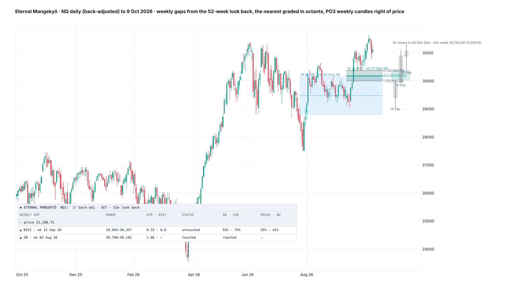

> **Merged into [Mangekyō](../mangekyo/) v3 (4 Nov 2026):** set *View → Timeframe* to *Weekly · Eternal Mangekyō*. This folder keeps the weekly research and the last standalone script.

# Eternal Mangekyō

**Mangekyō's weekly form: the weekly fair value gaps, volume imbalances and suspension blocks from the last 12, 26 or 52 weeks, the most local above and below price, graded in octants, with the gap's weekly candles right of price (PO3) and a countdown to the weekly close, a "mitigated when" choice, and tested reach and hold odds.**

TradingView indicator, Pine Script v6. Open source under the Mozilla Public License 2.0. *Not yet published on TradingView.*

Files: `Eternal_Mangekyo.pine` (the script), `TradingView_description.txt` (publication text), `research/` (the tests and fits; no market data included).

*Mock-up from NQ daily (back-adjusted) to 9 Oct 2026, drawn in Python; TradingView rendering will differ.*

**Eternal Mangekyō** (永遠の万華鏡, "Eternal Kaleidoscope") is the Mangekyō's final form in Naruto: the eye that no longer fades with use. Mangekyō reads the daily candles; this one reads the weekly candles, whose gaps outlive the daily ones by months. It is Mangekyō's sister, built so that Mangekyō itself stays as it is: every new addition lives here.

*A map of the weekly PD arrays and their tested odds. It does not call direction.*

## What it draws

- **Weekly gaps** from the last 12, 26 or 52 weeks:
  - **FVG:** three weeks whose wicks leave a gap (BISI / SIBI);
  - **suspension block:** a week with a volume imbalance on both sides;
  - **volume imbalance:** two weekly bodies that do not meet.
- **Default sizes:** FVG ≥ 0.10 weekly ATR with a middle week ≥ 0.25 ATR; suspension block ≥ 0.10; imbalance ≥ 0.05. That leaves 8–10 FVGs, 3–4 blocks and 5–6 imbalances a year per market.
- **The most local** 2 above and 2 below price (1–8), plus any price is inside. The one price is in, or the nearest, is graded in octants across the chart with prices; the others get CE, quadrants or octants.
- **Mitigated when** *(new)*:
  - *Closed beyond (ICT)*: live until a weekly close beyond the far edge, after which an FVG turns inversion;
  - *Far edge traded*;
  - *CE traded*;
  - *Touched*.

  This week's range so far counts. It is a display choice: the odds don't change with it.
- **Inversion FVGs** after a close beyond, until a weekly close beyond the other edge.
- **The forming FVG:** this week's candle as candle 3, dashed, until the week completes.
- **Weekly wick CEs** of the last weekly swing candle, or of last week.
- **PO3:** the gap's two or three weekly candles right of price when price is inside it (or always), shaded and graded. A **countdown** *(new)* shows the time left until the weekly close (Friday 17:00 ET) and this week's range so far.
- **Data:** weekly candles from the chart, the front-month contract, the continuous 1! or the back-adjusted 1!, with bodies read at the settlement, the last trade or the wider of the two.

## Card

One row per gap above, inside and below price:
- name and displacement week;
- range;
- width in weekly ATR and distance from the last weekly close;
- status;
- **4W · 12W:** the chance the near edge trades within 4 and within 12 weeks;
- **HOLDS · 4W:** the chance the touch week holds the far edge, then that the gap is not closed beyond within 4 weeks;
- the middle week's volume and BOS.

Inside a gap, *THIS WEEK* gives the 4-week survival odds if the week closes where price sits. The Mobile layout keeps the nearest gap above and below.

## What the tests found

NQ, ES, RTY weekly 2010–26 and YM 2017–26, built from the back-adjusted daily front month: 731 weekly FVGs, 668 of them touched. Each gap was matched with 5 three-week windows that left no gap (same market and direction, within ±2 years, the middle week's body and the third week's close matched), as in Mangekyō's daily tests. Errors are clustered by week.

| Outcome (FVG) | Gap | No gap | Difference |
|---|---|---|---|
| Near edge back within 4 weeks | 65.8% | 68.7% | −2.9 ± 2.4 |
| Near edge back within 12 weeks | 76.5% | 80.3% | −3.8 ± 2.2 |
| CE traded within 12 weeks | 73.1% | 74.1% | −1.1 ± 2.4 |
| **The week of the first touch holds the far edge** | **43.7%** | **38.9%** | **+4.2 ± 2.0** |
| Not closed beyond within 4 weeks of the touch | 40.1% | 40.5% | +0.2 ± 2.4 |
| 1 weekly ATR bounce before a close beyond | 43.9% | 44.1% | +0.6 ± 2.5 |

- **The touch week holds** passes the suite's rule (p < 0.05, the same sign in 2010–24 and 2025–26, the same sign on NQ, ES and RTY):
  - NQ +4.7, ES +2.2, RTY +0.6, YM +12.7 points;
  - 2010–24 +3.6, 2025–26 +11.5.

  It is the same edge the daily gaps showed (+3.5).
- **As a draw,** weekly gaps are revisited slightly *less* often than the same candles without a gap, as on the daily chart. So the reach odds come from distance alone.
- **After the touch week,** there is no edge.

### Odds

- **Reach:** p = logistic(a + b·logit(2Φ(−d/(κ√h)))), with d the distance in weekly ATR(14) and h the weeks. Fit on the nearest live gap above and below at each weekly close.

  | 4 weeks, walk-forward 2014–26 | Predicted → actual | Brier (flat rate) |
  |---|---|---|
  | Gaps below price | 4→4, 18→15, 39→39, 58→71, 78→86, 93→100% | 0.113 (0.165) |
  | Gaps above price | 4→5, 20→14, 40→27, 59→41, 80→84, 95→85% | 0.158 (0.245) |

  Gaps above are fewer (590 rows against 2,280 below), so their fit is looser. For scale, a gap below 0.5 / 1 / 2 weekly ATR away trades within 4 weeks 63 / 34 / 12% of the time.
- **Holds from the width** (FVG):

  | Width (weekly ATR) | 0.1 | 0.25 | 0.5 | 1 |
  |---|---|---|---|---|
  | Touch week holds the far edge | 15% | 45% | 72% | 89% |
  | Not closed beyond in 4 weeks | 19% | 36% | 52% | 68% |

  Suspension blocks and imbalances have their own fits (`research/wk_par.json`).
- **The touch week's close** (FVG), and the chance the gap survives the next 4 weeks: back outside 61%, near half 51%, past CE 29%.

## Credits

Fair value gap, volume imbalance, suspension block, consequent encroachment, octant grading and PO3 are taught by ICT (Michael J. Huddleston). Built from Mangekyō's own code. Not affiliated with or endorsed by ICT.

## Research

`research/wk_gaps.py` is the gap-vs-no-gap test; `wk_fit.py` gives the reach, hold and body fits (`wk_par.json`); `mock_em.py` is the mock. They use Mangekyō's `gaps.py`, `feats.py`, `split.py` and `data.py`, which read the daily tables from the original workspace. No market data is included.

## License

Mozilla Public License 2.0.
