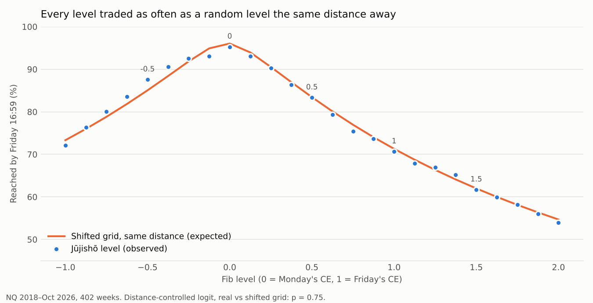
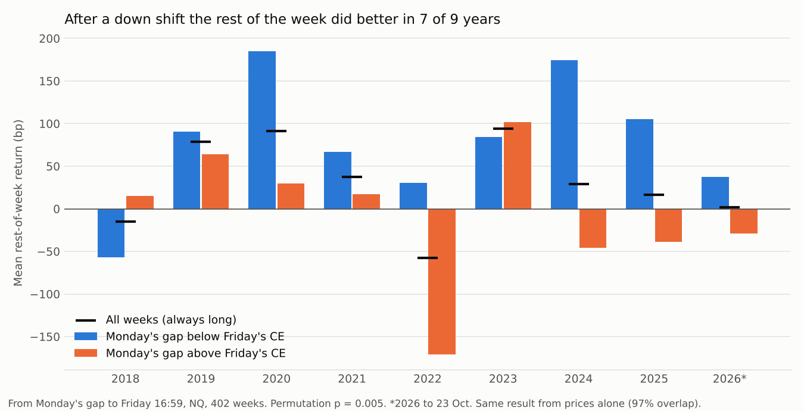

# Getsuga Jūjishō — Friday → Monday First Presented FVG Dealing Range

**Data:** NQ 1-minute, 2 Jan 2018 – 23 Oct 2026 (Barchart, CT → ET, one contract per day). 2,154 sessions with a 09:30 open; 431 candidate weeks, 29 roll weeks left out, **402 weeks** tested. NQ only.

**Verdict in one line:** the octants are a map, not a magnet; gap size says nothing about volatility once the open is known; coiled vs uncoiled changes how the grid plays out but not how far price travels; the one result that held is direction, and that is the Friday → Monday price reversal, not the FVGs.

---

## 1. Definitions

| Term | Definition |
|---|---|
| First presented FVG (FPFVG) | Byakugan's rule. On 1-minute bars from 09:30, the first three consecutive candles (all starting at or after 09:30, the third starting by 09:59) with a wick gap: bull = low₃ > high₁, bear = high₃ < low₁. Gap = high₁ → low₃ (bull) or high₃ → low₁ (bear). Presented at the third candle's close. |
| CE | Midpoint of the gap. |
| Anchors | **1 = Friday's FPFVG CE** (the last session of the prior week with one; Thursday on Good Friday), **0 = Monday's** (the first session of the week). |
| Range | R = 1 − 0, signed. Level(f) = 0 + f·R. Eighths from −1 to 2; SDs at 1.5 / −0.5 (and 2 / −1). |
| Set | The close of Monday's third candle. Everything after runs from the next bar to Friday 16:59. |
| AWR4 | Mean high–low range of the four prior chart weeks (Sun 18:00 → Fri 17:00). |
| Coiled | \|R\| ≤ 0.20 × AWR4 (the median is 0.19×; 52% of weeks). Uncoiled otherwise. |
| Shift | Down shift: the price at Monday's third candle is below Friday's CE. Up shift: above it. |
| Shifted grid (null) | The same week's grid moved by a random fraction of an eighth: same spacing and distances, wrong phase. |

Errors are clustered by week or Newey-West. Splits are 2018–23 / 2024–26 (fit / score) or 2018–24 / 2025–26 where stated. The five weekday tests use a Bonferroni factor of 5.

---

## 2. What the range looks like

- 99.8% of sessions print an FPFVG by 09:59. The third candle starts at 09:34 median (10–90%: 09:32–09:41), so the range is usually set at **09:35**.
- Gap size: median 4.5 pts (middle half 1.75–9.75). Bullish 52%. Friday's and Monday's gaps overlap in 0.2% of weeks.
- |R|: median **107 pts = 0.19× AWR4** (10 / 25 / 75 / 90%: 0.03 / 0.08 / 0.34 / 0.52×). Its size moves with Tenshō's (correlation 0.89, same direction 87%).
- The rest of the week covers a median **0.90× AWR4**. It closed between the anchors **11%** of the time.

**Reached by Friday 16:59, from the set**

| −1 | −0.5 SD | 0 (Mon) | 0.5 EQ | 1 (Fri) | 1.5 SD | 2 |
|---|---|---|---|---|---|---|
| 72% | 88% | 95% | 83% | 71% | 62% | 54% |

Both SDs: 52%. Neither: 3%.

**Where first touches land by day** (share of all level first-touches): Mon 60%, Tue 22%, Wed 9%, Thu 6%, Fri 3%. Most of the grid that will trade has traded by Tuesday's close.

---

## 3. Do the octants matter? No.

| Test | Jūjishō levels | Null | Result |
|---|---|---|---|
| Reached by Friday, distance-controlled logit | coef −0.002 | shifted grid | p 0.75 (2018–24 p 0.37; 2025–26 p 0.21) |
| Per level, observed − expected at the same distance | all 25 levels within ±2.5 percentage points | shifted grid | largest \|z\| 1.70 (−0.125), none significant |
| First touch holds (bounce 0.10 AWR4 before going 0.10 through) | 46.0% (n 6,885) | 46.2% | diff −0.2 pts, p 0.52 |
| Same, 0.05 AWR4 bracket | 48.7% | 49.1% | p 0.39 |
| Day highs within ±0.1 eighth of a level (uniform = 20%) | 21.4% | 20.5% | z +0.6 |
| Day lows | 18.5% | 19.5% | z −0.7 |
| Day closes | 22.9% | 20.5% | z +1.6, p 0.11 |

First-touch hold by tier (0.10 AWR4): anchors 43%, EQ 48%, quarters 48%, eighths 46–47%, SDs 1.5 / −0.5 48%, SDs 2 / −1 44%; shifted grid 46%. Every confidence interval covers the shifted grid's rate.

**Day by day** (none significant, before or after Bonferroni)

| Day | Reached that day (real / shifted) | p | Hold 0.10 (real / shifted) | p | Highs + lows on the grid (real / shifted) | p |
|---|---|---|---|---|---|---|
| Mon | 45.7 / 45.3% | 0.26 | 46.1 / 46.2% | 0.68 | 19.2 / 17.0% | 0.36 |
| Tue | 31.3 / 31.0% | 1.00 | 46.2 / 46.1% | 0.89 | 18.8 / 21.2% | 0.31 |
| Wed | 18.1 / 18.2% | 0.23 | 47.7 / 47.9% | 0.85 | 22.1 / 21.4% | 0.77 |
| Thu | 15.6 / 15.3% | 0.56 | 42.7 / 44.1% | 0.19 | 20.9 / 20.4% | 0.83 |
| Fri | 8.9 / 9.0% | 0.42 | 45.3 / 45.1% | 0.91 | 18.7 / 19.8% | 0.66 |

"Reached that day" = among levels not yet reached at the start of the day, distance-controlled.

Reading: the levels trade at exactly the rate their distance from price predicts, and price does not turn, pause or close on them more than on a random grid. The same was found for Tenshō. **The grid is a map of where price is against Friday's and Monday's gaps, not a list of turning points.**

---

## 4. Does gap size predict volatility? Not beyond the opening range.

**Every NQ session (2,072, holiday sessions left out):** log range after the gap, fit 2018–23, scored 2024–26.

| Model | Rest of day (→ 16:59), out-of-sample R² | NY AM (→ 10:59), out-of-sample R² |
|---|---|---|
| RTH ADR5 | 0.296 | 0.300 |
| Gap size only | −1.055 | −1.089 |
| ADR5 + gap | 0.286 | 0.315 |
| ADR5 + 09:30 → gap range | **0.387** | **0.467** |
| ADR5 + 09:30 → gap range + gap | 0.391 (gap coef −0.010, t −0.9) | 0.468 (−0.003, t −0.4) |

| Gap ÷ ADR5 quintile | Median gap | Rest of day ÷ ADR5 | 09:30 → gap ÷ ADR5 |
|---|---|---|---|
| G1 (smallest) | 0.75 pts | 1.02 | 0.22 |
| G2 | 2.75 | 1.01 | 0.23 |
| G3 | 5.00 | 0.97 | 0.23 |
| G4 | 8.75 | 1.02 | 0.26 |
| G5 (largest) | 14.25 | 1.15 | 0.33 |

The largest gaps come with bigger days only because they form in a fast open (the opening range is 50% larger). Once that range is known, the gap adds nothing. By weekday the gap coefficient is −0.007 to −0.033 (Friday p 0.039; 0.20 after Bonferroni).

**Week level** (rest-of-week range ÷ AWR4, fit 2018–23, scored 2024–26): Monday's recent range (RTH ADR5 ÷ AWR4) gives out-of-sample R² 0.113; adding Monday's 09:30 → gap range 0.155. Adding Monday's and Friday's gap sizes: 0.168, coefficients p 0.39 and 0.83. The range size \|R\| adds nothing (p 0.43).

---

## 5. Coiled vs uncoiled

| | Coiled (≤ 0.20× AWR4) | Uncoiled (> 0.20×) |
|---|---|---|
| Weeks | 208 | 194 |
| Median \|R\| | 39 pts (0.08×) | 180 pts (0.35×) |
| Rest of the week, mean (median) | 0.98× AWR4 (0.86) | 1.05× (0.97) |
| Closed between the anchors | 5% [3–9] | 18% [13–24] |
| Closed beyond an SD | **90%** [85–93] | **63%** [56–70] |
| Closed beyond 2 / −1 | 86% [81–90] | 39% [32–46] |
| Both SDs traded | **76%** | **26%** |
| Reached 1.5 / 1 / 0.5 / −0.5 | 82 / 86 / 91 / 94% | 40 / 54 / 75 / 80% |

- **This is spacing, not volatility.** A coiled grid is tight, so the week's normal travel runs through all of it. In AWR4 units the rest of the week is only slightly smaller after a coiled range (Spearman \|R\| vs rest-of-week range +0.18; 2018–23 +0.20, 2024–26 +0.16, p 0.08). That disappears once Monday's recent daily range is in the model (p 0.19). A level the same AWR4 distance away traded no more often in a coiled week (p 0.22).
- **Coiled does not mean compression before expansion.** Uncoiled weeks were slightly *more* volatile, because a wide Friday → Monday gap comes with an already volatile tape.

Use on the chart: in a coiled week, treat the SDs as likely to go (the week closed beyond one 90% of the time). In an uncoiled week the grid holds more of the week.

---

## 6. Direction: the one result that held, and what it really is

| From the set to Friday 16:59 | Weeks | Week up | Mean | 5% trimmed |
|---|---|---|---|---|
| Down shift (Monday's gap below Friday's CE) | 177 | **62%** [54–69] | **+78 bp** | +73 bp |
| Up shift | 225 | 56% [50–62] | −3 bp | +2 bp |
| All weeks (always long) | 402 | 58% [54–63] | +33 bp | — |

**Robustness:**
- Permutation p 0.005; Mann-Whitney p 0.022. Positive in 7 of 9 years (2018 and 2023 the exceptions).
- 2018–21: +45 bp, p 0.24. 2022–26: +112 bp, p 0.010.
- 2018–23: +52 bp, p 0.13. 2024–26: +148 bp, p 0.014. Most of it is recent.
- Fridays and Mondays only, no holiday sessions: +79 bp, p 0.007. Without 2020: +74 bp, p 0.016.
- In coiled weeks: +84 vs −11 bp, p 0.017. Uncoiled: +71 vs +5 bp, p 0.14.

**It is not the FVGs:**
- The same split on raw prices (Monday's 09:3x price vs Friday's) agrees in 97% of weeks and gives +78 bp, p 0.008. In one regression neither survives the other (FVG split p 0.43, price split p 0.82).
- It is a step, not a slope: per AWR4 of Friday → Monday move, −66 bp, p 0.21.
- Splitting on Tenshō's anchors (Shikai mids) instead: +17 bp, p 0.59. The overnight mids catch it less well than the 09:3x prices.
- Monday's gap *direction* says the same thing: after a bearish Monday FPFVG the week rose 63% [57–70]; after a bullish one, 54% [47–61]. On any single day the gap's direction predicts nothing (2.5 bp per side, p 0.32).
- Friday's CE is no magnet either. After an up shift it was reached 68% of the time, against 74% for the mirror level; after a down shift 75% against 71%. The gap between the two is upside drift.

**Against always-long** (rest of the week, no costs):

| Period | Always long | Long only after a down shift | Long after down / short after up |
|---|---|---|---|
| 2018–26 | +13,169 bp, Sharpe 0.83 | +13,874 bp, Sharpe 1.17 (44% of weeks) | +14,578 bp, Sharpe 0.92 |
| 2018–23 | +10,959 bp, Sharpe 1.02 | +8,669 bp, Sharpe 1.09 | +6,380 bp, Sharpe 0.59 |
| 2024–26 | +2,211 bp, Sharpe 0.42 | +5,205 bp, Sharpe 1.34 | +8,199 bp, Sharpe 1.61 |

**By day** (each day's return after a down vs an up shift):

| Day | Down | Up | Diff | p | Bonferroni |
|---|---|---|---|---|---|
| Mon (from the set) | +13 bp | +13 | 0 | 0.99 | 1.00 |
| Tue | +20 | −5 | +26 | 0.07 | 0.35 |
| Wed | +19 | +17 | +1 | 0.93 | 1.00 |
| Thu | +12 | −13 | +25 | 0.14 | 0.68 |
| Fri | +18 | −11 | +29 | 0.054 | 0.27 |

No single day carries it; it builds across Tuesday, Thursday and Friday.

**Verdict:**
- This is the short-term weekly reversal in NQ: a lower Monday than Friday leans the rest of the week up.
- The FVGs only date-stamp it.
- It beat always-long on total return only in 2024–26; in 2018–23 it had less total return and about the same Sharpe.
- By the house rule (no edge unless it beats the always-long carry benchmark out of sample), it is **a lean for context, not a model**. The card shows it as SHIFT with these numbers.

---

## 7. The odds on the card

Tenshō's by-Friday model was fitted on Shikai-mid levels (NQ + ES + RTY 2018–24). Its inputs are the distance from price in AWR4 and the time left. Scored on the Jūjishō levels at the set and at each day's close, it needs no refit:

| Predicted | Levels | Observed |
|---|---|---|
| 0–20% | 6,122 | 8% (pred 9%) |
| 20–40% | 3,800 | 34% (pred 30%) |
| 40–60% | 3,365 | 54% (pred 50%) |
| 60–80% | 3,805 | 69% (pred 70%) |
| 80–90% | 2,531 | 84% (pred 85%) |
| 90–95% | 2,245 | 93% (pred 93%) |
| 95–100% | 1,934 | 97% (pred 97%) |

- Brier 0.145 against 0.250 for the base rate; in 2024–26, 0.144 against 0.246.
- Worst bin: 4 points. By checkpoint (set / Mon / Tue / Wed / Thu close), observed vs predicted within 3.4 points.
- Getsuga uses the same constants for both ranges.

---

## 8. Jūjishō vs Tenshō

| | Tenshō | Jūjishō |
|---|---|---|
| Anchors | Overnight midpoints (18:00 → 09:29) | CE of the first 1-minute FVG after 09:30 |
| Set | Monday 09:30 | Monday's third candle, median 09:35 |
| Median size | 0.19× AWR4 | 0.19× AWR4 |
| Octants as magnets / reaction levels | No | No |
| Odds model | Distance + time | Same model, calibrated within 4 pts |
| Direction split | +17 bp, p 0.59 | +78 vs −3 bp, p 0.005 (the price reversal) |

The two ranges agree in direction 87% of the time, and their anchors sit a median 0.06–0.07× AWR4 apart. Jūjishō adds the 09:3x price snapshot, which is where the direction lean lives.

---

## 9. The week of 26 Oct 2026

**Known on Friday's close** (the data end 23 Oct 16:59):

| Item | Value |
|---|---|
| Friday 23 Oct FPFVG | Bearish, 29,051.50 – 29,053.00 (1.50 pts), candles 09:32 – 09:34 |
| **1 = Friday's CE** | **29,052.25** |
| Price at Friday's gap / Friday's close (16:59) | 29,040.00 / 29,175.00 |
| PWH / PWL (week of 19 Oct) | 30,113.00 / 28,987.00 |
| Tenshō's 1 (Friday's Shikai mid) | 29,142.50 |
| AWR4 | 1,224 pts (weeks of 28 Sep – 19 Oct: 926, 825, 2,021, 1,126) |
| RTH ADR5 | 417 pts |
| Coiled band | Monday's CE within ±245 pts of 29,052.25 → **28,807 – 29,297** |

**Monday's gap sets 0.** Expect it by about 09:35 (90% by 09:41). Then:

- **State.** A CE inside 28,807 – 29,297 is coiled: SDs both trade 76% of the time and the week closes beyond one 90%. Outside the band it is uncoiled (26% and 63%).
- **Shift.** If price at Monday's gap is below 29,052.25, it is a down shift: historically the week rose 62% (+78 bp). Above it is an up shift: 56% (−3 bp). Friday closed 123 pts above the CE, so an open near Friday's close points to an up shift. A lean, not a signal (§6).
- **Range expected for the rest of the week:** about 0.92× AWR4 ≈ **1,130 pts** (middle half 880 – 1,420), from the week-level model with this week's ADR5 and a typical Monday open (§4). A quiet open (25th percentile) gives about 1,070 pts; a fast one (75th) about 1,180.

**Levels for a few Monday CEs** (level = M + f·(29,052.25 − M)):

| Monday CE (0) | \|R\| | State | Shift | 1.5 SD | 0.5 EQ | −0.5 SD |
|---|---|---|---|---|---|---|
| 28,750 | 302 | uncoiled | down | 29,203.38 | 28,901.12 | 28,598.88 |
| 28,950 | 102 | coiled | down | 29,103.38 | 29,001.12 | 28,898.88 |
| 29,150 | 98 | coiled | up | 29,003.38 | 29,101.12 | 29,198.88 |
| 29,350 | 298 | uncoiled | up | 28,903.38 | 29,201.12 | 29,498.88 |

**Odds that a level trades by Friday, from its distance at the set** (AWR4 1,224): 50 pts 94%, 100 pts 90%, 150 pts 85%, 250 pts 76%, 400 pts 61%, 600 pts 44%, 900 pts 27%. Friday's CE at 29,052.25 sits 65 pts above PWL (28,987.00). With Monday anywhere near Friday's close, 1 is likely to trade early in the week, on distance alone.

On the chart, the week card shows all of this live once the gap prints: state, shift, both gaps, the ladder and the odds.

---

## 10. Limitations

- NQ only, 402 weeks. A weekly test has few independent points: the direction result rests on 177 vs 225 weeks, and it is concentrated in 2022–26.
- The data are raw front-month contracts, so roll weeks are dropped. On a back-adjusted continuous chart those weeks would show a range.
- "Price at Monday's gap" is the close of its third candle. On the chart the card uses the same price.
- These are historical frequencies, not guarantees, and not financial advice.

**Scripts:** `build.py` (sessions and FPFVGs), `weeks.py` (ranges, levels, shifted grids, holds, phases), `t_levels.py`, `t_states.py`, `t_dir.py`, `t_calib.py`, `t_binary.py`, `pine_port_check.py` (the Pine detection, replayed on 15-minute bars, matches the research detection on every 2025–26 session).
