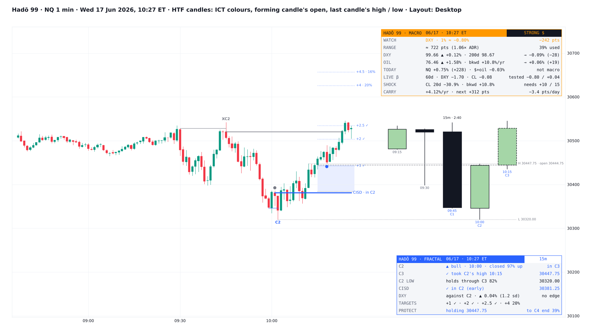
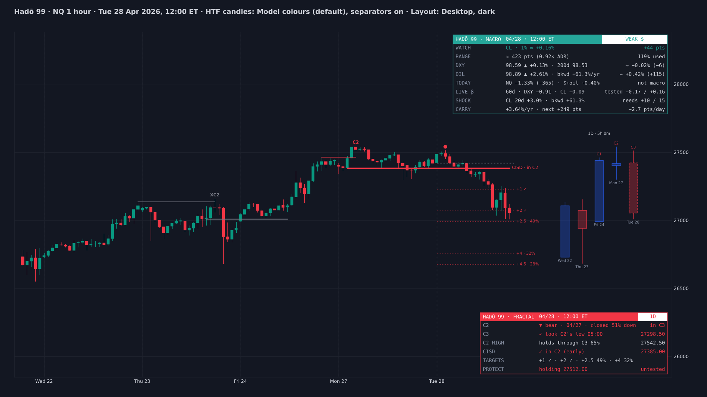
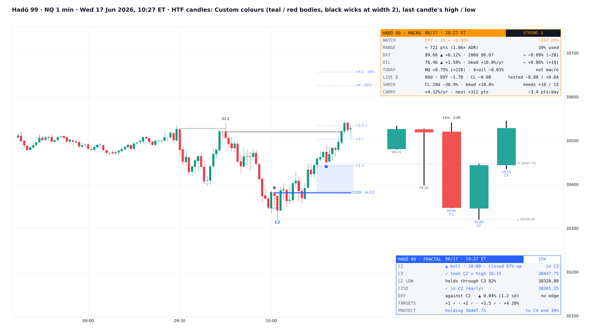
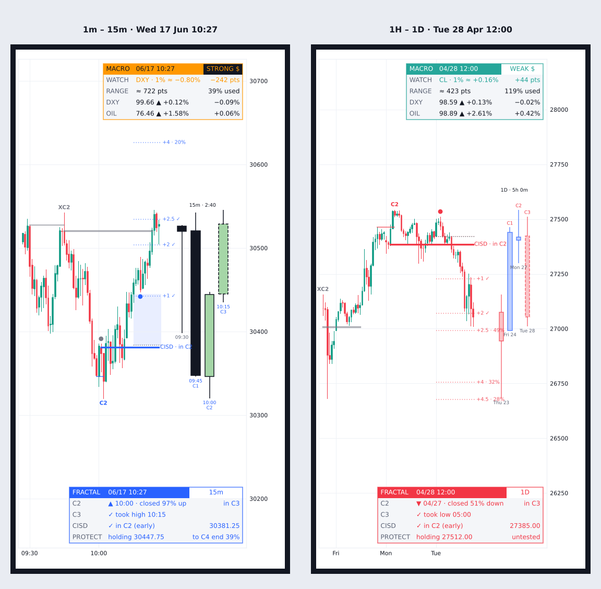

# Hadō 99

**Macro Regime + Fractal Model for NQ, ES & RTY**

TradingView indicator, Pine Script v6. Open source under the Mozilla Public License 2.0. *Not yet published on TradingView; the earlier version (without the HTF candle settings) is in [hado-99](https://github.com/unclehk2000/hado-99).*

Files: `Hado_99.pine` (the script), `TradingView_description.txt` (publication text), `research/` (the tests behind the odds and the mock-up scripts; no market data included).

*Mock-up of how it looks on the chart: HTF candles in the ICT colours, with the forming candle's open and the last closed candle's high / low.*

**Hadō 99** puts two things on one chart, each on its own card:

- **Macro:** which macro force the index is moving with today (the dollar or oil), how hard, and the range to expect.
- **Fractal:** the C2 → C3 Fractal Model drawn on price, with odds for every step.

Every number on both cards was measured on NQ, ES and RTY 2018–26. A result is only shown if it held at p < 0.05 (errors clustered by date), in both 2018–24 and 2025–26, and on each of the three markets. *It is a map of how these setups and regimes usually behave, not a signal generator.*

## Macro card

**The regime** (the header pill), worked out from yesterday's closes:

- **WEAK $**: DXY below its 200-day average. The index follows oil: 1% on CL ≈ +0.16 to +0.22% on the index. The dollar matters little.
- **STRONG $**: DXY above its 200-day average. The dollar leads: 1% on DXY ≈ −0.75 to −0.95%. Oil barely matters.
- **OIL SHOCK**: CL's front month 15%+ a year above the second month, and CL up 10%+ in 20 days. Both turn against the index: 1% DXY ≈ −1.05 to −1.50%, 1% CL ≈ −0.10 to −0.13%. Together they explain about 30% of the day's move, against 6–13% in the other regimes.
- Share of days 2018–26: weak 42%, strong 52%, shock 6% (28% so far in 2026).

**Rows**

- **WATCH:** what to watch in this regime, and the index points per 1% move in it.
- **RANGE:** the range to expect today in points, and how much of it is used so far. For sizing targets and stops (see below).
- **DXY** and **OIL:** each one's move against its prior close, and the index move that goes with it in this regime, in % and points.
- **TODAY:** the index's move, and how much of it the dollar and oil account for.
- **LIVE β:** the same two-factor betas measured on the last 60 days, next to the tested ones. Far apart means the live link has drifted.
- **SHOCK:** how far CL is from the oil-shock rule.
- **CARRY:** the index carry (next contract over front, annualised), and the points a day the front month gives up to the cash index.
- Mobile layout keeps WATCH, RANGE, DXY and OIL. The rest stays in the tooltips.
- An alert fires when the regime changes.

**RANGE: what it is built on**

- The regime itself did *not* change the day's range. A big dollar or oil day did.
- After a day when DXY or CL moved 2+ daily standard deviations (about 1 day in 10), the next day ran **0.10–0.19× ADR20 larger** than the index's own recent range implied (p < 0.01, both periods, every symbol).
- Expected range = ADR20 × the average range / ADR20 that followed a day like yesterday. Rows are yesterday's own range (under 1, 1–1.5, and 1.5+ × ADR20):
  - normal day: 0.92 / 1.06 / 1.33×;
  - after a 2+ sd DXY or CL day: **1.07 / 1.16 / 1.51×**.
- DXY's overnight move added nothing to the New York session's range once the index's own overnight range was known, so it is not used.

**What the macro card does not do**

- Neither DXY nor CL led the index: not over the next minutes, the rest of the day, the next session or the next week.
- A gap between the index's move and what the dollar implies did not close by 16:00.
- The carry did not lead the next week's return, its range, where it closed, or a take of the prior week's high or low.

*So the regime, WATCH, DXY, OIL and TODAY are context: what is moving the index and by how much. RANGE is the forward-looking row.*

## Fractal model: what it draws on price

Bullish shown; bearish is the mirror image.

- **C2**: a higher-timeframe candle sweeps the previous candle's (C1's) low and closes back above it. It is labelled at its low, with a line from C1's low to the sweep. If C2's low is later broken, the label turns to **XC2** and the setup keeps only its label, the sweep and a grey CISD line.
- **EQ and T-spot**: C2's midpoint, and the zone from C3's open to EQ, shaded during C3.
- **CISD**: the highest open of the run of down-closing bars that delivered C2's low (up to 10 bars back). It is confirmed by the first close above it, and labelled *CISD · in C2* when that happens inside C2. While C2 is still forming, an **early CISD** shows as a dashed line.
- **Projections**: CISD + k × (CISD − C2's low) for k = +1, +2, +2.5, +4 and +4.5, each with its odds, ticked ✓ when hit.
- **Protected swing** (●): after the CISD, the first down-closing bar arms a level at its open. The level moves to the open of the down run into each new low. A close back above it marks the lowest 3-bar swing low in between. Greyed if taken before C4 ends.
- **HTF candles (PO3)**: the last 5 higher-timeframe candles drawn right of price, oldest on the left, the one still forming on the right with a dashed border.
  - Tagged C1–C4 for the latest setup: under the candles for a bullish setup, over them for a bearish one.
  - Each candle's open time (15-minute) or day (daily) under it, and the pair with a countdown to the close over them.
  - **Colours:** *Model* (the setup's blue / red, see-through bodies), *ICT* (green up bodies, black down bodies, black borders and wicks, white instead of black on a dark chart), or *Custom*: your own body, border and wick colour for up and down candles.
  - Wick width, candle width and the gap between candles (auto by chart timeframe), and the offset from price.
  - Optional: the forming candle's open, the last closed candle's high and low (the levels it must sweep to make a C2), and separators on the chart where each candle opened.

**Pairs**

- **1m chart, 15-minute candles**.
- **1H chart, daily candles** (the CME day, 18:00–17:00 ET).
- *Auto* picks 15-minute candles on charts of 5 minutes or less, and daily candles on longer intraday charts.
- Other chart timeframes still run, but the card marks the odds *untested*.

## Fractal card

The header takes the colour of a live setup (blue bull, red bear), and goes grey when there is none. The pill shows the pair.

- **C2:** side, time (or day), where C2 closed in its own range, and whether price is in C3, in C4 or done.
- **C3:** the odds C3 takes C2's high, for that close location. Once C3 trades back to EQ, the lower EQ odds. A tick and the time when it happens.
- **C2 LOW** / **C2 HIGH:** the odds C2's swept extreme holds through C3, or the time it broke.
- **CISD:** confirmed in C2 (early), or the time it confirmed, or waiting. With its price.
- **DXY** (15-minute pair): DXY across the C2 candle, and whether it moved the setup's way.
- **TARGETS:** the projections with their odds, ticked as they are hit.
- **PROTECT:** the protected swing's price and its odds of holding to the end of C4, by bars left.
- Mobile layout keeps C2, C3, CISD and PROTECT.
- Alerts: new C2, CISD confirmed, protected swing marked.

## What the tests showed (fractal)

NQ, ES and RTY 1-minute data 2018–26: 248k C2s on 15-minute candles, 3,089 on daily candles. Figures are **15m / 1D**.

**Where C2 closes decides C3.** C3 took C2's high, by C2's close location (bottom → top quarter of its range):

- 15m: 21 / 36 / 55 / **78%**;
- 1D: 20 / 39 / 58 / **83%**.

*Against other candles that closed in the same place, a C2 was not followed by more expansion (−1.6 / −3.2 points). The pattern adds nothing to C3 beyond where it closes.*

**After C3 trades back to EQ**, the odds C3 still takes C2's high, by the same quarters:

- 15m: 21 / 35 / 47 / 64%;
- 1D: 19 / 38 / 52 / 70%.

**C2's swept low held through C3:**

- 15m: 28 / 48 / 67 / 82%;
- 1D: 19 / 46 / 65 / 81%.
- That is **+1.7 / +3.4 points** more often than other candles' lows at the same close location, and **+2.8 / +7.4** when the CISD confirmed inside C2.

**CISD:** confirmed inside C2 on 66 / 74% of C2s, and by the end of C4 on 88 / 91%. Once close location is accounted for, an early CISD does not raise the odds C3 takes C2's high.

**Projections** reached before C4 ended, after the CISD confirmed:

- +1: **72 / 80%**;
- +2: 46 / 57%;
- +2.5: 36 / 49%;
- +4: 20 / 32%;
- +4.5: 16 / 28%.

**Protected swings** (15-minute pair, 140k swings):

- They held to the end of C4 **9.5 points more often** than other 1-minute swing lows with the same bars left and the same distance from price. 49% held overall.
- By bars left in C4 when marked: ≤5: **93%**; 6–10: 77%; 11–15: 64%; 16–20: 52%; 21+: 39%.
- A CISD inside C2 added 4.8 points.
- *Not tested on daily candles; the card says so.*

**DXY during C2** (15-minute pair, 2023–26, 93k C2s):

- When DXY moved the setup's way by more than 0.5 sd (1 C2 in 4), C2's extreme held through C3 **1.7 points** more often, and C3 took C2's other extreme 1.3 points more often, at the same close location.
- DXY moving against the setup changed nothing.
- *A small edge on top of the close-location odds, not a signal by itself.* On daily candles, neither DXY nor CL made a difference.

**The macro regime made no difference to any fractal odds.**

## Settings

**View** sits at the top, the same as in my other indicators:

- card theme;
- layout (Desktop / Mobile);
- Macro card on/off and position;
- Fractal card on/off and position;
- card text size.

**Markets:** the dollar index (default TVC:DXY), CL front and second month, and the index's next contract (blank = auto).

**Regime rules (as tested):**

- backwardation threshold (15%/yr);
- oil 20-day threshold (10%);
- DXY average length (200 days);
- the live beta row and its length;
- the regime-change alert.

**Fractal model:**

- on/off;
- pair (Auto, 1m – 15m, 1H – 1D);
- setups kept;
- CISD and early CISD;
- EQ and T-spot;
- projections;
- protected swings;
- bull and bear colours;
- alerts.

**HTF candles (PO3):**

- on/off and how many (2–10);
- offset from price, candle width and gap (0 = auto);
- colours: Model, ICT or Custom (body, border and wick, up and down);
- wick width;
- C1–C4 tags, times, countdown;
- forming candle dashed;
- the forming candle's open, the last closed candle's high / low, separators, each with its colour.

## How to use

- Built for CME index futures: **NQ / MNQ**, **ES / MES** and **RTY / M2K**. Micros use their full-size contract's tested values.
- Use a continuous, back-adjusted chart (*B-ADJ*) with extended hours, so the daily candles and the ranges are the full CME day.
- **Fractal:** a 1-minute chart for the 15-minute pair, a 1-hour chart for the daily pair. Those are the tested combinations.
- **Macro:** works on any intraday chart. CL and DXY need their data on your plan; delayed data delays those rows.
- Give the two cards different places. If you also run Shikai / Bankai Session Map, set the HTF candles' offset to 70 or more so they sit beyond its session candles.
- For alerts, create one alert on *Any alert() function call*.

## Data and method

**Macro**

- NQ, ES and RTY daily data 2018–26.
- DXY: ICE daily closes; DX futures 5-minute bars (2023–26).
- CL: front and second-month settles; 1-minute bars around FOMC weeks.
- Regimes are set from yesterday's closes. The betas come from two-factor regressions of the index's daily % change on DXY's and CL's, by regime.
- RANGE: 6,500 symbol-days. Range = the CME day's high − low; ADR20 = the mean of the previous 20.

**Fractal**

- NQ, ES and RTY front-month 1-minute data, Jan 2018 – Oct 2026.
- 15-minute candles from the 1-minute bars; daily candles (CME day) on 1-hour bars.
- Odds are plain frequencies. Each comparison is a linear probability model with errors clustered by date:
  - C2s against all other candles that closed in the same place;
  - protected swings against other 1-minute swings with the same bars left and distance.

**On the chart**

- The higher-timeframe candles are built from the chart's own bars. That costs no extra data request and matches the tests.
- Daily macro values use finished bars only.
- DXY across C2 uses the finished 15-minute candle.
- Protected swings are marked on closed bars.
- Nothing sees future data.

## Limitations

*These are historical frequencies, not guarantees.*

- The odds were measured on NQ, ES and RTY. Other symbols show the same tables without a test of their own.
- The DXY tests used DX futures; the card uses TVC:DXY by default (you can change it).
- Chart timeframes other than 1m (15-minute pair) and 1H (daily pair) are untested, and the card says so.
- Nothing here is financial advice.

## Why the name

**Hadō #99, Goryūtenmetsu**, sits at the top of the numbered destructive kidō. Only the strongest kidō users can cast it; Aizen turns it on Yhwach in the final arc. This indicator started life as a single macro card (Bakudō 58). With the Fractal Model built in, it outgrew that name.

## Credits

- **The Fractal Model** (C2, C3, C4, the T-spot, CISD projections): *TTrades*.
- **CISD** (change in state of delivery), **EQ** and sweeps: ICT concepts (*Michael J. Huddleston*).
- The protected-swing idea and parts of the model's mechanics were studied from community Fractal Model scripts (*Open Source Fractal* and *FM°*); the HTF candles' colour, wick and layout options were inspired by *FM°*'s.
- DXY and CL data via TradingView (TVC:DXY, NYMEX:CL1! / CL2!).
- Written from scratch; no code from other scripts. Open source under MPL 2.0.

## Add it to TradingView

1. In TradingView, open the **Pine Editor** (bottom panel).
2. Copy the contents of `Hado_99.pine` into a new script.
3. **Save**, then **Add to chart**.

## More screenshots

## License

Mozilla Public License 2.0, see [LICENSE](../LICENSE). © Unclehk2000.

*Historical frequencies, not guarantees. Nothing here is financial advice.*
