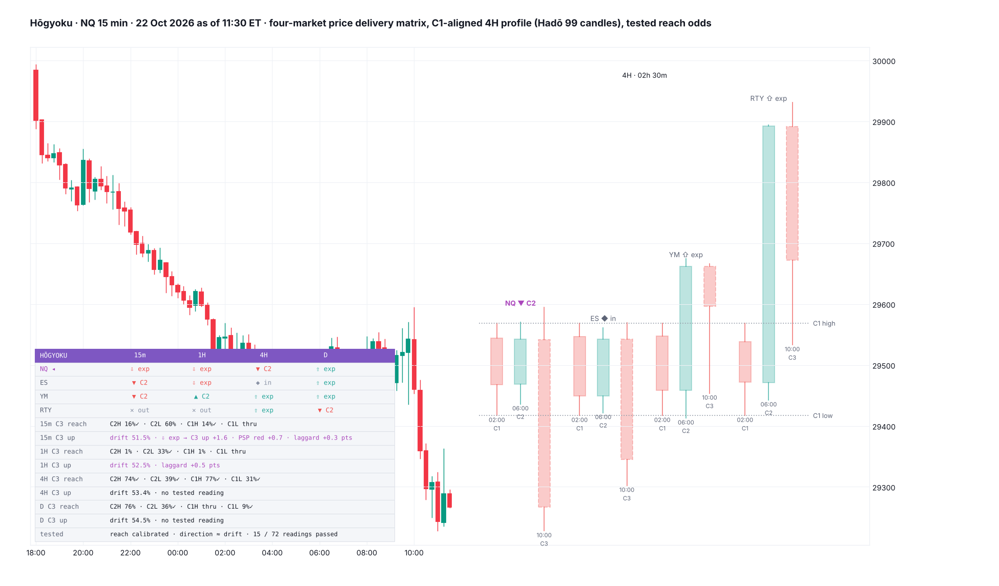

# Hōgyoku

**A four-market HTF profiler: NQ, ES, YM and RTY on 15m, 1H, 4H and D at once. It shows:**
- **the price delivery matrix:** each market's C2 against its C1;
- **the four markets' C1-C2-C3 side by side,** aligned on C1;
- **reach odds for the forming candle,** each market with its own calibration;
- **the matrix readings that passed HYDRA,** each with its tested edge over the drift.

TradingView indicator, Pine Script v6. Open source under the Mozilla Public License 2.0. *Not yet published on TradingView.*

Files:
- `Hogyoku.pine`: the script.
- `TradingView_description.txt`: the publication text.
- `research/`: the matrix build, the HYDRA tests, the reach fits and the port check (no market data included).

*Mock-up from NQ 15-minute candles, 22 Oct 2026 as of 11:30 ET, with the 4H profile of all four markets, drawn by a Python port of the script; TradingView rendering will differ.*

**Hōgyoku** (崩玉, "Breaking Orb") is the orb Kisuke Urahara created in Bleach, the one Aizen spent a century chasing. It reads the hearts of everyone around it and gives shape to what they want. This indicator reads the markets around your chart. It shows what each of the four index futures is delivering on each timeframe, and only the readings that survived testing carry a number.

*Reach odds and tested context. It does not call direction: on these timeframes, direction is mostly drift.*

## What it shows

- **The matrix:** four markets × four timeframes. Each cell is that market's last completed candle (C2) against the one before (C1):
  - **▲ C2:** swept C1's low and closed back above it;
  - **▼ C2:** the mirror;
  - **⇧ / ⇩ exp:** closed beyond C1's high / low;
  - **◆ in:** inside bar;
  - **✕ out:** outside bar.

  The tooltips give the sweeps, where C2 closed in C1's range and C2's move in ATR.
- **The profile:** the four markets' C1, C2 and the forming C3 for one timeframe, drawn right of price.
  - Drawn with Hadō 99's candle system: offset, width / gap (0 = auto), Model / ICT / Custom colours, wick width, C1–C3 tags, times, the countdown to C3's close, and the forming C3 dashed.
  - Each market is scaled so its C1 high and low land on the chart market's.
  - A sweep in one market and not another (SMT) or opposite candle colours (PSP) show at a glance.
- **C3 reach:** for the chart market on each timeframe, the chance the forming candle trades through C2's high, C2's low, C1's high and C1's low.
  - Calculated from the distance at C3's open, with the chart market's own calibration.
  - ✓ marks a level that has traded.
- **C3 up:** the chart market's drift on that timeframe, plus every matrix reading active now that passed the suite's rule, with its tested edge in points for that market.
- **Individual sensitivity:**
  - **reach:** each market carries its own fitted reach calibration;
  - **sweeps:** each market has its own sweep threshold in ticks. 0 is the tested setting; any other value keeps the matrix but marks the readings untested.
- **Alert:** a tested reading on the profile timeframe.

## How it was tested

**Data.** NQ, ES, YM and RTY 1-minute, 2018 – 23 Oct 2026, built into 18:00-anchored 15m, 1H, 4H (18, 22, 02, 06, 10, 14) and D candles. Only candles present in all four markets were kept, and pairs crossing a contract roll were dropped.

| Timeframe | Aligned candles (each market) |
|---|---|
| D | 1,973 |
| 4H | 12,541 |
| 1H | 48,542 |
| 15m | 193,482 |

Everything was fit on 2018–24 and scored once on 2025–26.

The work followed the Kaizen QC story:

### 1. Theme
Turn a profiler into a tool whose every number is tested, and use HYDRA to find the cross-market regressions hidden in the price delivery matrix.

### 2. Situation (the baseline)

- **Drift.** The next candle closes up from C2's close on a share of candles with no signal at all:

  | Timeframe | Closes up, 2018–24 | 2025–26 |
  |---|---|---|
  | D | 53.5% | 52.8% |
  | 4H | 53.3% | 52.0% |
  | 1H | 52.2% | 51.6% |
  | 15m | 51.3% | 50.9% |

  Any bullish reading looks right that often with no skill. So every reading below is measured against the drift, not 50%.
- **Own candle, direction:** gradient-boosted trees on each market's own C1→C2 geometry (sweeps, close location, move, wicks, ranges) predicted direction no better than the base rate. AUC was 0.503–0.515.

  | Timeframe | Gain over the base rate (mnat, 95% CI) |
  |---|---|
  | 4H | −0.06 [−0.50, +0.34] |
  | 1H | −0.61 [−1.22, +0.11] |
  | 15m | +0.20 [−0.21, +0.61] |

- **Own candle, reach:** the same inputs predicted reach almost entirely. AUC was 0.80–0.94 for C3 trading through C2's or C1's extremes. That is geometry, and it is what the reach odds use.

### 3. Root cause: why the matrix says so little about direction (five whys)

1. **The four markets deliver together.** On 15m, a bull C2 in one market came with all four sweeping the low 56% of the time.
2. **What differs between them is a small residual** of four highly correlated index futures.
3. **That residual is arbitraged quickly.** Basket and index arbitrage close relative mispricings within minutes, so on 15m only a sliver is left, and on 1H and above almost none.
4. **SMT and PSP look strong on a chart** because they are drawn at swings after the fact. Tested forward from the candle's close, most of them are drift.
5. **The drift itself flatters any bullish reading.**

### 4–6. Countermeasures, built and assessed

- **The cross-market machine-learned increment.** Gradient-boosted trees on own + all three partners' matrices, against own-only, scored on 2025–26:

  | Target | Change from adding the partners (mnat) |
  |---|---|
  | Direction, 4H | −1.99 [−4.21, −0.08] |
  | Direction, 1H | −0.37 |
  | Direction, 15m | +0.03 |
  | Reach, any timeframe | −1.05 to +0.90; none significantly positive |

  **The full matrix adds nothing out of sample beyond each market's own candle.** The model is left out.

- **The cross-market positive regression that exists.** On 15m, C3's return loads negatively on the market's own C2 move and positively on the other three's: the laggard catches up. Coefficients are own / partners' C2 move, with t-statistics in brackets:

  | Market | 2018–24 | 2025–26 |
  |---|---|---|
  | ES | −0.112 / +0.103 (t −5.1 / +4.9) | −0.083 / +0.072 (t −2.9 / +2.5) |
  | YM | −0.103 / +0.089 (t −6.2 / +5.9) | −0.129 / +0.095 (t −4.3 / +3.4) |
  | RTY | −0.177 / +0.155 (t −10.2 / +10.1) | −0.060 / +0.027 (t −3.0 / +1.4); decayed |
  | NQ | −0.012 / +0.014 (t −0.8 / +1.1) | weak |

  On 1H and 4H it is not consistent.

- **Every ICT matrix reading against the drift.** 72 tests: 18 readings × 4 timeframes, covering formations, SMT both ways, all four swept, PSP, laggard / leader, all four C2. **15 passed the suite's rule** (p < 0.05 clustered by day, the same sign in 2018–24 and 2025–26 and on all four markets); about 3.6 would by chance. The edges are points of "C3 closes up" over the drift, pooled across the four markets:

  | Timeframe | Reading | Edge over the drift |
  |---|---|---|
  | 15m | Expansion candle → C3 reverses | 2.0 / 2.1 points (t 11) |
  | 15m | PSP → C3 against the candle's colour | 0.8 / 1.1 |
  | 15m | Laggard / leader fifth vs the other three → catch-up | 1.0 / 1.1 (t 7–8) |
  | 15m | Held its high while a partner swept → up | 0.5 |
  | 1H | Bull C2 → up | 1.2 |
  | 1H | Bull C2 with all four sweeping the low → up | 1.4 |
  | 1H | All four bull C2 → up | 2.1 |
  | 1H | Expansion up → C3 down | 1.8 |
  | 1H | Held its high while a partner swept → up | 1.0 |
  | 1H | PSP red → up | 1.1 |
  | 1H | Laggard → up | 0.8 |
  | 4H | **Bull C2 + SMT (≥1 partner held its low) → up** | **2.5** (2018–24 +1.6, 2025–26 +6.0) |

  Nothing passed on D (1,973 candles). Bear C2, the bearish SMTs and "all four bear C2" did not pass on any timeframe.
- **Combined, the readings still add little.** One logistic model per market and timeframe on the passing readings, scored on 2025–26:

  | Model | Gain over the base rate (mnat, 95% CI) |
  |---|---|
  | 15m pooled | +0.17 [−0.07, +0.43] |
  | 15m, YM | +0.59 [+0.20, +1.02] |
  | 1H | −0.28 |
  | 4H | −0.30 |

  So the card shows each reading's tested edge on its own, as context, and no combined direction probability.
- **Reach odds.** One calibration per market, timeframe and level: p = logistic(a + b·logit(2Φ(−d))), with d the distance from C2's close in ATR.
  - Out-of-sample gain over the base rate: 85–227 millinats.
  - Calibration on 15m and 4H is off by 2.3 and 2.5 points on average (90% of bins within 5–6 points).
  - On 1H it is off by 4.8 on average and timid above 65%: 65 → 66–83%.
  - Each market's (a, b) is its own sensitivity.

### 7. Standardise

The two rules every number above had to meet are now written into this indicator's card and README:
- the suite's rule;
- the drift as the null for direction.

The machine-learned direction model, the DOL / ADR table (it duplicates Shinsō and Ryūjin Jakka) and CISD (not tested here) are left out.

**The port check:**
- The script's formation logic matched the research labels on 100% of candles on every timeframe.
- Its reach odds, with the in-script normal-CDF approximation (error 2.1 × 10⁻⁷), matched the exact model to within 4.4 × 10⁻⁶.

## Credits

The GXV HTF Profiler-PRO by Gregorius_XV and cdikici71 (MPL-2.0), with El3mentss's DOL / ADR rework, was studied for its concepts: C1-C2-C3 HTF profiling, SMT, PSP. None of its code is used; this is built from scratch. SMT divergence and the HTF candle reading are taught by ICT (Michael J. Huddleston). Not affiliated with or endorsed by ICT or GXV.

## Research

| File | What it does |
|---|---|
| `research/t18_build.py` | Builds the aligned matrix |
| `t18_a1.py` | Formation and SMT / PSP rates |
| `t18_a2.py` | Cross-market regressions |
| `t18_a3.py` | Machine-learned own vs cross ablation |
| `t18_a4.py` | Catch-up per market |
| `t18_a5.py` | Every reading against the drift |
| `t18_a6.py` | Combined readings |
| `t18_a7.py` | Reach calibrations |
| `gen_pine.py` | Writes the script |
| `mock_hg.py` | Port check and mock |

No market data is included.

## License

Mozilla Public License 2.0.
