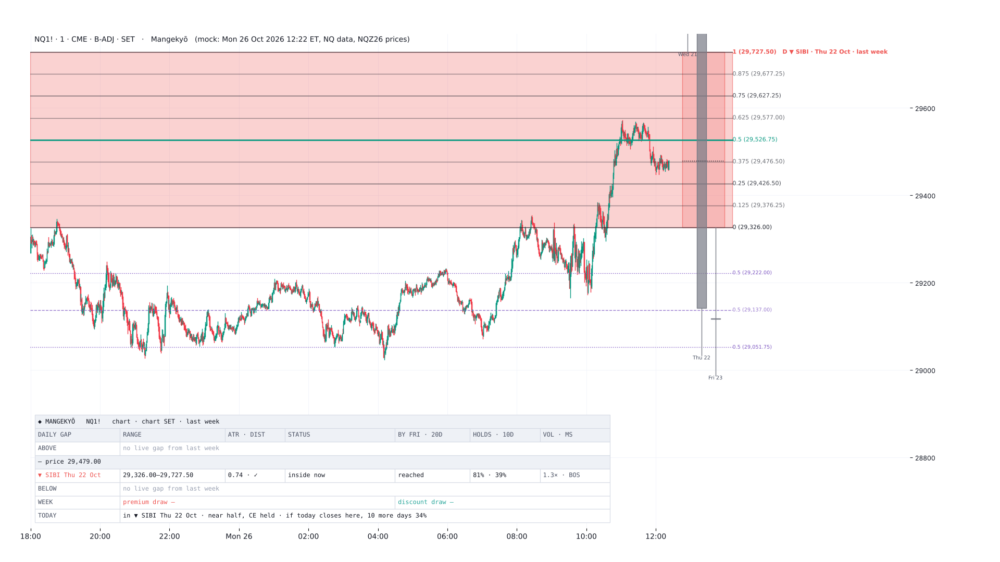
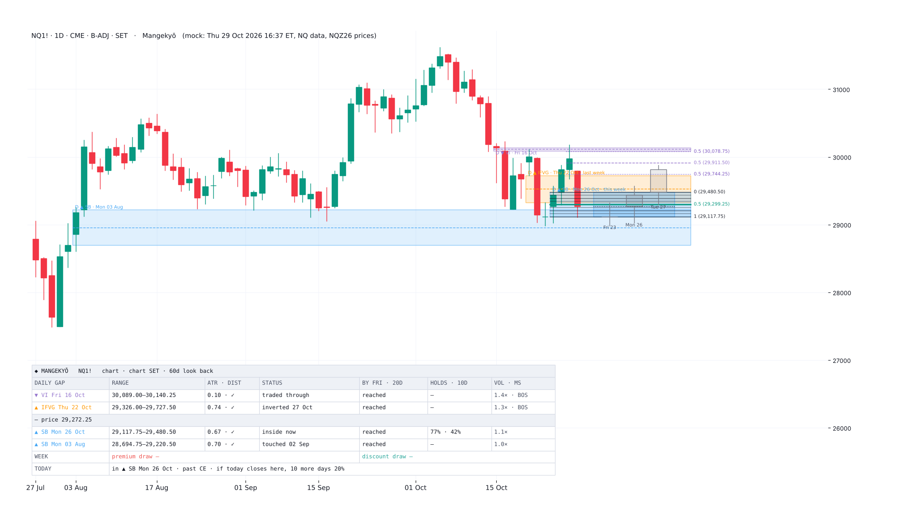

# Mangekyō

**万華鏡 · "Kaleidoscope", the Sharingan's next stage.** Sharingan reads the quarter's look back. Mangekyō reads the daily candles inside it: the higher-timeframe fair value gaps, volume imbalances and suspension blocks that ICT grades from the daily chart.

## What it draws

- **Daily gaps** from the last 20, 40 or 60 trading days (the IPDA look backs), or from this week and / or last week only:
  - **FVG**: BISI or SIBI, three candles whose wicks leave a gap.
  - **Suspension block**: a candle with a volume imbalance on both sides.
  - **Volume imbalance**: two bodies that do not meet.
- **Gaps from** (setting): the look back, *This week + last week*, *Last week* or *This week*. ICT trades inside last week's FVG with its octants; the week settings drop the older gaps (e.g. a large August suspension block) so last week's FVG and this week's gaps stand alone. A gap belongs to the week its last candle closed in.
- **The most local ones**: the nearest live gaps above and below price (2 each by default), plus any gap price is inside.
  - Overlapping gaps on the same side merge: an FVG (live, then inverted) wins over a suspension block, which wins over an imbalance. An inversion FVG is no longer hidden under a suspension block that overlaps it.
- **Anchored as ICT draws them**: an FVG or imbalance from its first candle, a suspension block from the suspended candle.
  - Each is named by its displacement candle, e.g. ▼ SIBI Thu 22 Oct.
  - Prices are rounded to the tick, as ICT labels them.
- **Inversion FVGs**: an FVG closed beyond is kept, in orange, as support or resistance from the other side, until a daily close beyond its other edge.
- **Daily wick CEs**: the premium and discount wick CEs of the last daily swing candle (or yesterday's), and the midpoint between them, as on ICT's daily chart. A wick CE that sits on a line of the graded gap is named in that line's label (*0.875 (29,136.50) · wick CE 29,137.00*), so the two never print over each other.
  - Yesterday counts as the swing while it is pending: a lower low (higher high) than the day before that today has not traded past. So on Monday 26 Oct it shows Friday's 29,222.00 / 29,051.75 / 29,137.00, as ICT had them from Friday 17:00.
- **Grading**: CE, quadrants or octants on every gap. The gap price is inside (with a week setting, else the nearest one) is graded as ICT grades it on his 1-minute chart: a solid line at every eighth across the whole chart, edges and quadrants stronger, CE in green, each line's fraction and price at the right end, e.g. *0.625 (29,577.00)*. 0 = near edge, 1 = far edge, as the gap formed.
  - Intraday, the gap's name goes on its top line (its first candle is off screen); on a daily chart only the edges, CE and, for wider gaps, the quadrants are labelled, so the labels do not pile up.
- **PO3**: when price trades inside a gap, the 2 or 3 daily candles that made it are drawn right of price, with the gap shaded and a line at the price now. Their size scales with the timeframe (wider on 1–5 minute charts).
- **Forming FVG**: today's candle as candle 3, dashed. It joins the list at the next session's open; over a weekend, Friday's gap shows here.
- **The card**, per gap:
  - range, width and distance in ATR;
  - status (untouched, touched, past CE, traded through, inside now);
  - reach odds by Friday and in 20 days;
  - hold odds;
  - the middle candle's volume and whether it broke structure.
- **The week** (a card row): the nearest gap above is the week's premium draw, the nearest below its discount draw, each with its by-Friday odds.
- **Today** (a card row): where today's body sits against CE, and the odds of the next 10 days from there.

## Daily data

| Setting | Options |
|---|---|
| Daily candles from | Chart symbol · Front-month contract · Continuous 1! · Continuous 1!, back-adjusted |
| Body close | As the chart (SET setting) · Widest of the two (ICT) · Settlement (SET on) · Last trade (SET off) |

- **Settlement:** a daily body ends at the settlement (TradingView's SET) or at the 17:00 ET last trade. Wicks are the same either way, so FVGs don't change, but imbalances and suspension blocks do.
  - By default Mangekyō reads the bodies your chart shows, so every zone lines up with its candles.
  - Widest of the two reads both and keeps the wider imbalance, as ICT toggles SET to find the widest. A zone read with the other close gets a dashed border.
  - Example, NQZ26 on 20 Oct 2026: settlement 29,688.00 makes a down candle; the last trade, 29,893.75, makes an up candle.
- **Front month vs continuous:**
  - The unadjusted 1! jumps by the carry at each roll. That was 0.44–0.69 ATR in 2022–26, more than a typical daily gap is wide (0.28 ATR).
  - A contract's own chart includes its thin deferred months. In front-month mode, gaps from those months can be hidden.
  - Back-adjusted 1! has neither problem.

## What the tests found

NQ, ES, RTY daily 2010–26 and YM 2017–26. Every gap was matched with 5 three-candle windows that left no gap (same symbol and direction, within ±2 years, the same middle-candle move and candle-3 close). The full tables are in [research/Mangekyo_Daily_Gaps_Findings.md](research/Mangekyo_Daily_Gaps_Findings.md).

| Claim | Gap | No gap | Verdict |
|---|---|---|---|
| Price returns to the gap (20 days) | 83.7% | 85.9% | Not a draw |
| The first touch day holds the far edge | 48.7% | 45.0% | +3.5 points, t 3.7. Holds in 2010–24 and 2025–26 and on NQ, ES and RTY; not on YM |
| Not closed beyond within 10 days of the touch | 29.3% | 28.4% | No edge |
| High-volume middle candle (touch day holds) | 55.4% | 55.1% | No edge; at equal width −2 points |
| Gap formed on a break of structure | 52.4% | 47.5% | +4.9 points, but at equal width only +4 (z 1.6), none on NQ or in 2025–26 |
| The nearest gap is reached by the week, above / below | 65.5–67.6% / 58.9–61.0% | 65.6–67.8% / 60.2–62.8% | Same as any level as far away |
| ICT's body rule: touch day closed back outside / near half / past CE, then 10 days | 44% / 34% / 16% | 43% / 31% / 21% | Describes depth, at any level |
| Inverted FVG retest holds the touch day | 43.5% | 44.4% | No edge |

What the card's odds come from:
- **Reach odds**: the gap's distance and the days left, because gaps were reached as often as any level as far away. Walk-forward 2014–26 (5 days): 6→5%, 21→22%, 41→36%, 60→57%, 81→79%, 95→94% above; 6→10%, 21→22%, 40→41%, 60→61%, 80→82%, 95→95% below.
- **Hold odds**: the gap's width. For an FVG, the touch day holds 48% at 0.25 ATR wide, 71% at 0.5 and 87% at 1 ATR. Locked test 2025–26: 11→14%, 37→41%, 59→57%, 79→82%.
- Volume and structure are shown on the card, not scored.

## Notes

- Daily data is read from completed days only, so nothing repaints. Today's touches and the forming FVG come from the chart's own bars.
- Works on daily and intraday charts.
- Quarterly look backs live in [Sharingan](../sharingan/), the week's own range in [Getsuga Tenshō](../getsuga-tensho/), opening gaps (NWOG / NDOG) in OpenGaps and RTH gaps in [Benihime](../benihime-v2/).
- Built and checked locally (parser, lint, size and limits). v1 runs on TradingView; v1.1 and v1.2 are not yet compiled there.
- **v1.2 (29 Oct 2026):** the *Gaps from* setting, ICT-style grading of the gap price is in, the merge order (FVG first), pending-swing wick CEs (sharing the graded gap's label when they sit on one of its lines), PO3 sizes by timeframe, gap names on their first candle on a daily chart, prices with thousands separators. Checked against NQZ26 1-minute data to 29 Oct: Tuesday 27 Oct's 07:00–09:00 range (low 29,519.00 at 07:45, high 29,628.75 at 08:25) and its lows at 29,578.75 (10:29) and 29,615.00 (10:38–10:39) match ICT's.

## Why the name

**Mangekyō Sharingan** (万華鏡写輪眼, the *Kaleidoscope Copy Wheel Eye*) is the Sharingan awakened: the three tomoe fuse into a pattern of their own, and the eye sees further than before.

[Sharingan](../sharingan/) reads the quarter through its three tomoe, the 60, 40 and 20-day look backs. Mangekyō turns that same gaze inward, onto the daily candles inside the quarter, and splits each gap into eighths the way a kaleidoscope splits one image into mirrored segments. Its PO3 candles are its **Tsukuyomi**, the Mangekyō's genjutsu that holds its target inside a replayed world: while price trades through a gap, the days that made it are replayed beside it.

## Credits

Fair value gap, volume imbalance, suspension block, consequent encroachment, octant grading, PO3 and the weekly range are taught by ICT (Michael J. Huddleston). Not affiliated with or endorsed by ICT.

## Research

The `research/` folder holds the scripts. No market data is included; they read daily and 1-minute CSVs from the original workspace.

| Script | What it does |
|---|---|
| `data.py`, `candles.py` | Daily candles: unadjusted, back-adjusted, per contract; settlement vs last-trade closes |
| `gaps.py` | Detection and lifecycle |
| `feats.py`, `feats2.py` | Features and matched no-gap controls |
| `census.py`, `frontcont.py` | The census and front month vs continuous |
| `analyze1.py`–`analyze7.py`, `split.py` | Real vs control tests |
| `weekly.py` | The weekly-range test |
| `fit.py`, `wf.py`, `final_fit.py` | The card's odds |
| `emu.py`, `mock_mangekyo.py` | The Pine engine in Python, checked against `gaps.py`, and the mock-ups (daily, 1h, 15, 5 and 1 minute; look back or week settings) |

Mozilla Public License 2.0. © Unclehk2000. Research tools, not financial advice.
