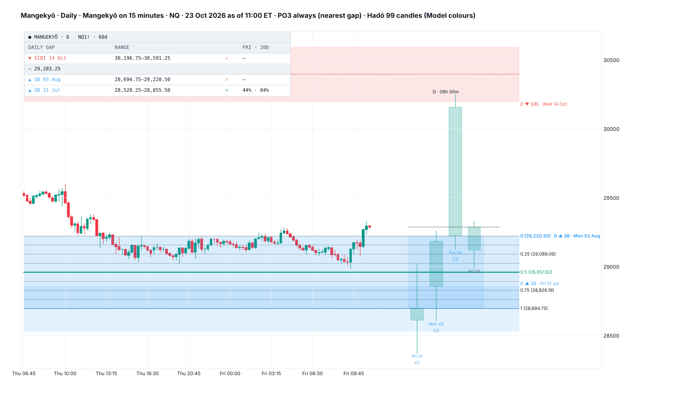
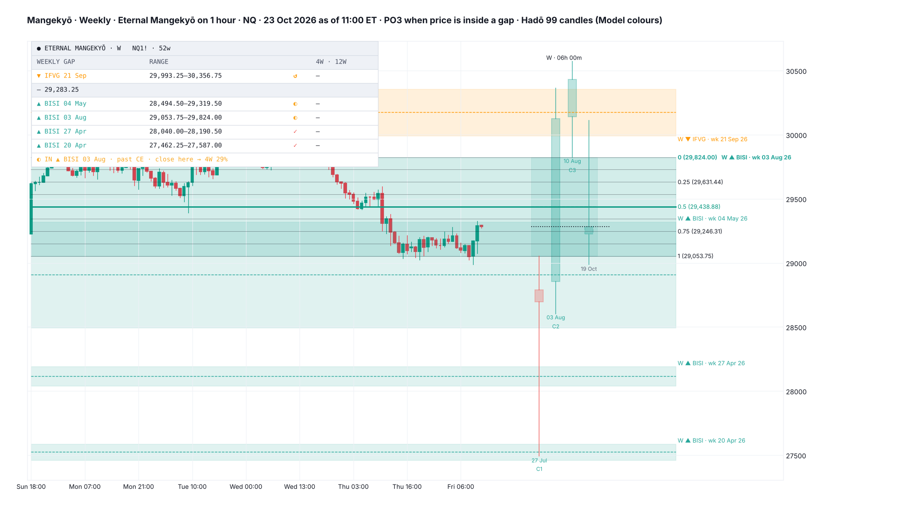

# Mangekyō

**Daily or weekly fair value gaps, volume imbalances and suspension blocks, in one script with one switch: Daily (Mangekyō) or Weekly (Eternal Mangekyō).**

It shows:
- **the most local gaps** above and below price;
- **the gap price is in**, graded in octants;
- **inversion FVGs** and the wick CEs of the last swing candle;
- **PO3 candles right of price**, with the candle forming now drawn live from the chart's own bars;
- **a compact ✓ / ✕ card** that keeps only what carries an edge.

TradingView indicator, Pine Script v6. Open source under the Mozilla Public License 2.0. *Not yet published on TradingView.*

Files:
- `Mangekyo.pine`: the script (v3.1: merged, with Hadō 99's candle system and text colours).
- `TradingView_description.txt`: the publication text.
- `previous/`: the daily v2 and Eternal v1 scripts.
- `research/`: the findings, plus `v3/` with the build and the mock.

| Daily · Mangekyō (15m chart, PO3 on the nearest gap) | Weekly · Eternal Mangekyō (1h chart) |
|---|---|
|  |  |

*Mock-ups from NQ, 23 Oct 2026 as of 11:00 ET, drawn by a Python port; TradingView rendering will differ.*

**Mangekyō** (万華鏡, "Kaleidoscope") is the Sharingan's next stage, and it dims each time it is used. The **Eternal Mangekyō** (永遠の万華鏡) is its final form, the eye that no longer fades. Daily gaps come and go within weeks; weekly gaps stay on the chart for months. One switch now opens either eye.

## What changed in v3 (the Kaizen record)

### 1. Theme
One Mangekyō with a clean daily / weekly switch, PO3 candles that never lag the chart, settings you can shape, and a card that carries edge rather than bulk.

### 2. Situation (before)

- **Two scripts** (Mangekyō 832 lines, Eternal 772) were 76–82% identical line for line. That was two uploads against TradingView's indicator limit, and every fix had to be made twice.
- **The card:**
  - 7 columns: gap, range, ATR · dist, status, reach, holds, vol · MS.
  - The two you sent were 49 and 70 cells.
  - Of the five data columns, only one carries an edge that passed the suite's rule: the touch hold. Daily 49% vs 45% for the same candles without a gap; weekly 43.7% vs 38.9%.
  - Reach is calibrated but comes from distance alone. Vol · MS was "shown, not scored" (no edge).
- **PO3:** the gap's candles plus a dotted price line. No candle for today or this week, and the whole drawing layer was deleted and rebuilt on every tick.

### 3. Root cause (five whys)

**Why the PO3 lagged:**
1. The forming candle was never drawn.
2. Everything came from the HTF request, which only holds completed candles.
3. On top of that, the drawing block ran a full delete-and-recreate of every line, label and box on each tick, about 45–55 objects in the mock layouts.
4. It did so because one function drew everything at once, with no split between what changes per tick and what changes per candle.

**Why the card was big:** every tested number got its own column, whether it carried an edge or not.

### 4–5. Countermeasures, built

- **One switch:** *View → Timeframe: Daily · Mangekyō / Weekly · Eternal Mangekyō.* It changes:
  - the request timeframe;
  - the look back (20 / 40 / 60 days or 12 / 26 / 52 weeks);
  - the tested filters for that timeframe;
  - the reach, hold and close-here models (both sets embedded);
  - names, labels, countdown and alerts.
- **Shared across both modes:**
  - the *Mitigated when* choice: closed beyond (ICT), far edge, CE or touched;
  - the *Hide deferred month* option.
- **No-lag PO3:**
  - The candle forming now is built from the chart's own bars and updated on every tick by moving four objects; nothing is re-created.
  - The static layer (gaps, grades, wick CEs, the gap's candles) is rebuilt only when what is on show changes or a new chart bar prints.
  - Unchanged ticks rebuild nothing, and the alerts reuse the same computed set.
- **PO3 candles: Hadō 99's candle system (v3.1)**, so the two scripts share one UI:
  - offset (bars right of price) and width / gap, 0 = auto: 6 and 3 on 1–2 minute charts, 4 and 2 up to 5 minutes, 2 and 2 above;
  - **Colours:** Model (the gap colours, see-through bodies), ICT (green up, black down, black borders and wicks; white on a dark chart), or Custom (body, border and wick, up then down);
  - wick width;
  - C1–C3 tags under a bullish gap's candles, over a bearish one's;
  - times, and the countdown over the candles;
  - forming candle on / off, dashed on / off;
  - Mangekyō's own gap shading and CE line.
- **Text colour (v3.1):** Auto (theme) or Custom, with one colour for the chart's labels and grade lines and one for the card's text. Use it when the chart background makes auto white or black hard to read; Theme still sets the card's background.
- **The card**, after El3mentss's DOL table (layout idea only; no code):
  - 4 columns: gap · range · status · odds, with status as one glyph (✕ untouched, ✓ reached, ◐ inside, ↺ inverted);
  - the odds column shows the reach odds while a gap is untouched, and the tested touch hold on the day / week of the first touch;
  - caution rows (amber) appear only when live: price inside a gap, with the tested chance it holds if the candle closes there; an FVG forming; and (daily) the week's premium / discount draw;
  - rows each side (1–4), the odds column and the caution rows are switches;
  - Mobile drops the range column;
  - the table is rebuilt only when its row layout changes.

### 6. Assessment (before → after)

| | Before | After |
|---|---|---|
| Scripts to maintain / upload | 2 | 1 (999 lines) |
| Card cells, daily (your screenshot → the mock) | 49 | 24 |
| Card cells, weekly (your screenshot → the mock) | 70 | 36 |
| Card columns | 7 | 4 (3 on Mobile) |
| Objects rebuilt per unchanged tick | about 45–55 | 0 (4–8 moved by setters) |
| Forming candle in PO3 | none | live, every tick |

The tested numbers are unchanged; they moved into the odds column and the tooltips.

### 7. Standardise

- **Draw, edge and context.** The rule for every card now reads: draw everything, but give a column only to numbers that carry an edge; context goes in tooltips.
- **Live and static layers.** The split between live and static drawing layers is the pattern for the other indicators' PO3 / HTF candles.

**Checks:** local lint, size and parse pass. It has not been compiled on TradingView yet.

## What it draws

- **Gaps:**
  - FVG (BISI / SIBI), suspension block and volume imbalance;
  - the most local each side, plus any gap price is inside;
  - overlapping gaps on the same side are merged;
  - anchored and named as ICT draws them, by the displacement candle.
- **The graded gap:** the one price is in (daily week settings: else the nearest) gets octants across the chart with prices, CE in green. The others carry CE, quadrants or octants.
- **Inversion FVGs:** kept in orange until a close beyond the other edge.
- **Wick CEs:** of the last swing candle (or the last candle).
- **The forming FVG:** dashed, moved live.
- **PO3:** the gap's candles (tagged C1–C3) plus the forming candle, drawn with Hadō 99's candle system, a dotted price line, and the countdown to the daily / weekly close over them.

## The card

| Column | What it shows |
|---|---|
| Gap | Name by displacement candle, coloured by kind |
| Range | Bottom–top (tooltip: CE and status) |
| ✓ | ✕ untouched · ✓ reached · ◐ price inside · ↺ inverted |
| Odds | **Untouched:** reach by Friday · in 20 days (daily) or in 4 · 12 weeks (weekly), from distance. **First touched today / this week:** the touch holds the far edge, from width |

Caution rows appear only when live:
- **◐ IN** … · near half, CE held · close here → 10D / 4W x%
- **◆ FORMING** …
- **WEEK DRAW** ▲ … · ▼ … by Fri

## The tests (unchanged from v2 / Eternal v1)

**Daily** (NQ, ES, RTY 2010–26, YM 2017–26):
- **Touch hold:** the touch day held the far edge 49% vs 45% for the same candles without a gap (t 3.7; passes on NQ, ES and RTY).
- **Reach:** walk-forward calibrated, but gaps were reached at the same rate as any level as far away.
- **No edge in the tests:** inversions, volume, structure and the close-here split.

**Weekly:**
- **Touch hold:** the touch week held the far edge 43.7% vs 38.9% (+4.2 ± 2.0; 2010–24 +3.6, 2025–26 +11.5; passes the suite's rule).
- **Reach:** Brier 0.113 / 0.158 vs 0.165 / 0.245 flat.
- **No edge in the tests:** after the touch week (40.1% vs 40.5%).

Details: `research/Mangekyo_Daily_Gaps_Findings.md` and the Eternal Mangekyō folder's research.

## Credits

Fair value gap, volume imbalance, suspension block, consequent encroachment, octant grading and PO3 are taught by ICT (Michael J. Huddleston). The compact ✓ / ✕ card layout was inspired by El3mentss's DOL table in his GXV HTF Profiler-PRO rework (no code used). Not affiliated with or endorsed by ICT.

## License

Mozilla Public License 2.0.
