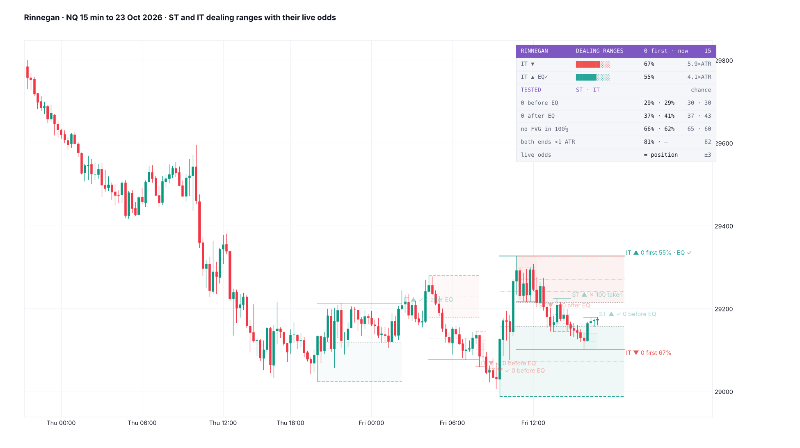
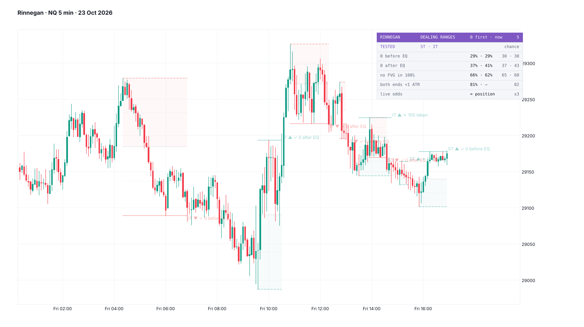
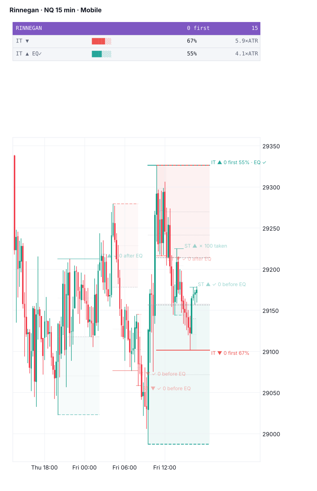
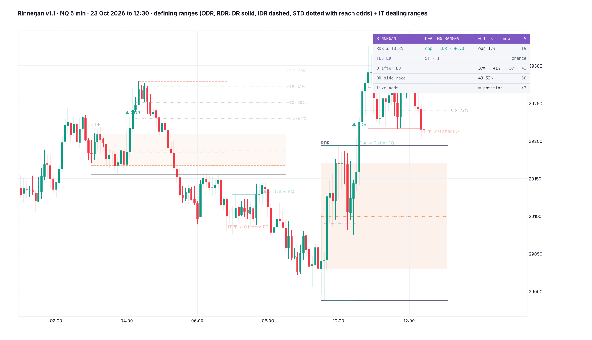

# Rinnegan

**Dealing ranges from a swept swing (100) to the next swing the other way (0), on short-term and intermediate-term swings, tracked live: EQ touched, 0 broken, 100 taken. Since v1.1 it also draws the defining ranges (DR / IDR) of the RDR, ODR and ADR hours, with STD lines. The odds on the card are the tested ones, and the popular range rules are shown next to their chance rates.**

TradingView indicator, Pine Script v6. Open source under the Mozilla Public License 2.0. *Not yet published on TradingView.*

Files: `Rinnegan.pine` (the script), `TradingView_description.txt` (publication text), `research/` (the tests behind the numbers; no market data included).

*Mock-ups from NQ 15- and 5-minute candles to 23 Oct 2026, drawn by a Python port of the script; TradingView rendering will differ.*

**Rinnegan** (輪廻眼, "Samsara Eye") is the third of Naruto's three great eyes, beside Sharingan and Byakugan, which already have indicators here. *Rinne* is the cycle of death and rebirth, and a dealing range lives that cycle: each one is born at a sweep, ends at 0 or at 100, and the next sweep starts another. The Rinnegan sees what the other eyes can't. This one shows what a range's levels actually do, next to what the popular rules say they do.

*A map of each range and its true odds. It does not call direction.*

## What it draws

- **Ranges.** A bullish range forms when a swing low that took the swing low before it is followed by a confirmed swing high. 100 is the low that swept; 0 is the highest high of the leg. A bearish range is the mirror.
  - **ST:** three-candle swings.
  - **IT:** an ST swing beyond the ST swings either side of it.
  - One range per sweep swing, at least 0.25 ATR wide (ATR = the mean high − low of the 14 candles before). The last 2 of each layer and side are kept.
- **Levels:** 0 (solid), 100 (dashed), EQ (dotted) and the quarters (faint). The 100 half (discount for a bullish range, premium for a bearish one) is shaded.
- **States**, from the candle after the range forms:
  - *EQ touched*;
  - *✓ 0 before EQ* (direct);
  - *✓ 0 after EQ* (the "completion");
  - *✗ 100 taken*;
  - *both on one candle*;
  - *retired* (neither end traded within 120 candles).
  - Finished ranges fade and stop at the candle that ended them.
- **Live label** on each running range, e.g. *IT ▲ 0 first 55% · EQ ✓*.

## Defining ranges · DR / IDR (v1.1)

- **The hours:** RDR 09:30–10:30, lines to 16:00; ODR 03:00–04:00, lines to 08:30; ADR 19:30–20:30, lines to 02:00 ET. Each can be turned off.
- **DR:** the hour's wick high and low (solid), drawn live as the hour forms.
- **IDR:** the high and low of the hour's 5-minute candle bodies (dashed), with its mid and a box.
- **Confirmation:** the first 5-minute close outside the DR after the hour, marked ▲ / ▼ with the session's name.
- **STD lines:** after the confirmation, half-IDR steps beyond the IDR on the confirmed side (4 by default, up to 10). Each is named with the share of 2025–26 sessions that reached it by the session end, e.g. *+1.0 · 42%* on the RDR.
- Runs on charts of 1–30 minutes that divide 30. Above 5 minutes the IDR uses the chart's candles, as the original script does; the tests used 5-minute bodies.
- On the card: *forming* (with the DR's size), *waiting* (the share of sessions that confirm), or the confirmed side and time with what has happened since. *opp ✗* means the other DR side traded, *IDR ✓* that price came back into the IDR, and *+1.0* is the furthest STD reached. Beside it go the share of sessions whose other side traded by the end, and the chance rate.

## Card

- **Live ranges** (newest first, up to 4): layer and side, a gauge of where price sits from 100 to 0, the chance 0 trades first, and the width in ATR. The tooltip has every level and every tested rate.
- **TESTED** rows (Desktop), ST · IT with the chance rate beside each:
  - *0 before EQ:* 29% · 29% (chance 30 · 30);
  - *0 after EQ:* 37% · 41% (chance 37 · 43);
  - *no FVG in the 100 half:* 100 taken 66% · 62% (chance 65 · 60);
  - *both ends, range under 1 ATR:* 81% (chance 82);
  - *live odds = position*, within 3 points.
- **Mobile:** the live ranges only, narrow.

## Alerts

One alert with "Any alert() function call" covers:
- range formed (off by default), EQ touched (off), 0 broken and 100 taken;
- DR confirmed, and the DR's other side traded (off).

## What the tests found

NQ, ES and RTY 1-minute, 2018 – 23 Oct 2026, built into 5-, 15- and 60-minute candles: 277,031 ST and 63,441 IT ranges. Fished on 2018–24 and scored once on 2025–26. Chance is the same price paths with each candle's direction flipped at random, which keeps volatility and removes direction (4 replicates). Errors are clustered by day.

| Rule (from "ICT Dealing Range Pro" and the lectures) | 2025–26 | Chance | Verdict |
|---|---|---|---|
| After the 50% retrace, 0 breaks before 100 ("completion") | ST 36.9%, IT 40.6% | 37.2%, 42.5% | chance; IT slightly below |
| 0 breaks before the 50% retrace (direct) | 29.5%, 29.4% | 29.5%, 30.0% | chance |
| Tip 1: no imbalance in the discount half → 100 fails more | 100 taken 65.7% (ST) vs 55.6% with one | 65.1% vs 56.3% | true as a count; the shape of the range does it |
| Tip 2: a tight range gets both sides swept | under 1 ATR 80.8%; 4+ ATR 34.0% | 81.9%, 35.0% | true as a count; distance does it |
| Live odds: 0 first = where price sits in the range | within 3 points at every tenth | — | holds: Brier 0.199 (ST), 0.189 (IT) vs 0.248 for a flat rate |

At each tenth of the range from 100 to 0, 0 traded first (ST, 2025–26): 8, 15, 25, 35, 44, 54, 64, 74, 84, 92%. IT: 4, 11, 21, 32, 42, 53, 64, 75, 87, 94%. Fitting those tenths instead of using the position itself does no better (Brier 0.1994 vs 0.1993).

### Defining ranges (DR / IDR)

NQ, ES and RTY 1-minute, 2018 – 23 Oct 2026: about 6,000 confirmed sessions of each kind, 1,200 of each in 2025–26. Chance = the same 1-minute paths from the confirmation with each candle's direction flipped at random.

| From the confirmation to the session end (2025–26) | RDR | ODR | ADR | Chance |
|---|---|---|---|---|
| A 5-minute close outside the DR came | 92% | 96% | 95% | — |
| The other DR side traded | 17.4% | 35.2% | 28.7% | 19.3 / 36.5 / 30.5% |
| Back into the IDR | 80.2% | 83.4% | 80.9% | 82.4 / 85.0 / 82.7% |
| +1 STD reached | 42% | 60% | 60% | 42 / 64 / 60% |
| +2 STD reached | 12% | 28% | 25% | 15 / 32 / 27% |
| The last close beyond the IDR mid, the confirmed way | 79.4% | 70.8% | 73.7% | 77.5 / 70.1 / 72.4% |
| **The confirmed side wins a race to an equal distance** | **51.6% ± 3.2** | **48.8% ± 2.3** | **49.8% ± 2.7** | **50%** |

"The other side holds about 80%" is true of the RDR (it holds 83%), but it is the distance: a full DR width away with a few hours left. The race in the last row removes the distance. From the confirmation close, the confirmed side and the DR's other side are put at the same distance, and the confirmed side gets there first half the time. The confirmation is a map of distances, not a direction call.

A live version of the reach odds was also tried, a Brownian touch model fitted per session on 2018–24. It held on the ODR and ADR in 2025–26 (Brier 0.134 vs 0.175 and 0.111 vs 0.153, calibrated within about 3 points). On the RDR its constant drifted (2.05–2.59 in 2018–25, 2.91 in 2026) and it overstated the middle of the range by up to 15 points. So the card shows the tested session rates instead.

**The port check:** the Python port of the DR / IDR engine, run on NQ 5-minute candles, gives the RDR's other side traded 18.2% (test 18.6%), IDR back 79.2% (79.3%) and +1 STD 45.2% (44.7%). The ODR and ADR are within 0.6 points too.

### Event-day ranges

The same check on the event-day dealing ranges in Hueco Mundo gave the same answer. After the 08:30–09:00 CPI window, the side that went first matched price's position within −2.6 ± 2.8 points (100 CPI days 2018–26).

**The Python port** of the script reproduces the test: on NQ 15-minute it finds 24,125 ST ranges against the test's 24,102 (the difference is roll days) and the same outcome shares to 0.1 points (failed 38.9%, direct 27.8%, complete 23.5%, both 9.0%). IT: 5,766 ranges against 5,745, again with the same shares.

## Notes

- The DR / IDR sessions run on charts of 1–30 minutes that divide 30.

- Built and tested on 5- to 60-minute charts. It runs on any timeframe, but other timeframes are untested.
- The odds are for the end that trades first, not for how far price goes after.
- Overlapping ranges are normal: a bearish range's 100 is often a bullish range's 0.

## Credits

Dealing ranges, premium / discount and swing terms are taught by ICT (Michael J. Huddleston). The range rules tested here come from "ICT Dealing Range Pro" by fadi, and the defining ranges from "DR/IDR" by TheMas7er and bmistiaen (MPL 2.0). All were studied, nothing copied. Written from scratch; not affiliated with or endorsed by any of them.

## Research

`research/t1_dr.py` builds the ranges and walks them against the sign-flip null; `a1.py` reports the rates; `t8_drpos.py` gives the live-odds calibration; `mock_rng.py` is the port, the port check and the mocks. DR / IDR: `t11_dridr.py` and `a11.py` (rates vs chance), `t11b_sym.py` (the equal-distance race), `t11c_live.py` (the live model that was not used), `mock_dr.py` (port, port check, mock). They read 1-minute arrays from the original workspace. No market data is included.

## License

Mozilla Public License 2.0.
