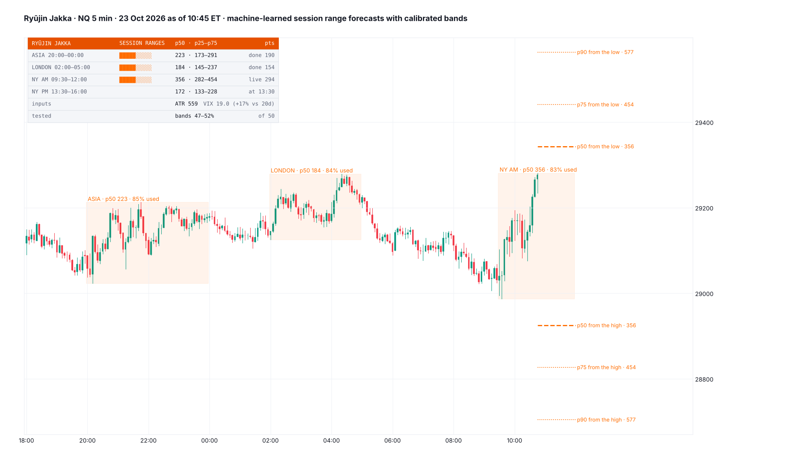

# Ryūjin Jakka

**Session range forecasts. The expected high-to-low range of the Asia, London, NY AM and NY PM sessions, with calibrated 25–75% and 10–90% bands, made at each session's start by one linear model per session. While a session runs, the forecast ranges are projected up from its low and down from its high.**

TradingView indicator, Pine Script v6. Open source under the Mozilla Public License 2.0. *Not yet published on TradingView.*

Files: `Ryujin_Jakka.pine` (the script), `TradingView_description.txt` (publication text), `research/` (samples, fits, the release-day test, the port check; no market data included).

*Mock-up from NQ 5-minute candles, 23 Oct 2026 as of 10:45 ET, drawn by a Python port of the script; TradingView rendering will differ.*

**Ryūjin Jakka** (流刃若火, "Flowing Blade, Like Fire") is Head Captain Genryūsai Shigekuni Yamamoto's zanpakutō in Bleach, the oldest and strongest fire-type. Its heat is the measure of its power. This indicator measures how hot each session is likely to burn: how far it will run from high to low.

*How far each session runs. It does not call direction.*

## What it shows

- **Each session shaded** (Asia 20:00–00:00 ET, London 02:00–05:00, NY AM 09:30–12:00, NY PM 13:30–16:00), labelled with its forecast median range and how much of it is used: *NY AM · p50 356 · 83% used*.
- **While a session runs:** the forecast p50, p75 and p90 ranges measured up from the session's low and down from its high. If the low is in, the high would sit at *p50 from the low* when the session reaches its median range.
- **Card:**
  - each session's forecast p50 with its 25–75% band in points, a gauge of the range used against p90, and live / done (with *>p90* or *<p10* when it ran outside the band) / the start time;
  - sessions not yet started show a provisional forecast from what is known now, fixed at their start;
  - on release days, the tested release-day effect;
  - the inputs (daily ATR, VIX against its 20-day mean) and the test score.

  Mobile shows the four sessions.
- **Alert:** a session passes its 90% range.
- Intraday charts up to 30 minutes.

## How the forecast is made

- **Target:** each session's log(high − low ÷ daily ATR(14) of the prior days).
- **Inputs, all known at the session's start:**
  - the same session's log range yesterday and its 5- and 20-day means (a HAR model, as used for realised volatility);
  - today's range and the move from the 18:00 open so far;
  - the session before it today (Asia uses its own yesterday);
  - daily ATR against its 60-day mean, the prior VIX close against its 20-day mean;
  - CPI, NFP and FOMC days, and a release falling inside the session (NY AM: CPI / NFP; NY PM: FOMC);
  - the weekday.
- **Model:** one linear regression per session, fit on NQ, ES and RTY 1-minute data 2018–24 (16,279 sessions); the bands are the 10 / 25 / 50 / 75 / 90% quantiles of its 2018–24 residuals. The coefficients and quantiles are embedded in the script. The past ranges come from a 30-minute request that keeps its own daily ATR.

### What the tests showed

Scored once on 2025 – Oct 2026 (4,058 sessions), never used in fitting.

| Session | R², 20-day mean | R², gradient-boosted trees | **R², linear model** | In 25–75% band | In 10–90% band |
|---|---|---|---|---|---|
| Asia | 0.00 | 0.26 | **0.30** | 48.8% | 76.8% |
| London | −0.02 | 0.31 | **0.34** | 49.5% | 77.4% |
| NY AM | 0.05 | 0.28 | **0.29** | 52.2% | 80.4% |
| NY PM | 0.07 | 0.33 | **0.38** | 46.6% | 76.2% |

- R² on the log range, against each session's 2018–24 mean. The trees (80, depth 3) were tried first and did worse on every session, so the script uses the linear model.
- The bands hold close to their nominal 50% and 80%, in 2025 and in 2026 separately (45.7–52.6% and 74.9–81.9%).
- The median runs a little high in London and NY PM: 56.7% and 55.3% of sessions ended below p50.
- Median session range, 2025–26: Asia 0.20, London 0.23, NY AM 0.55, NY PM 0.30 daily ATR.
- What moves the forecast most: the 20-day mean (coefficient 0.23–0.46), today's range so far (0.13–0.31) and VIX against its 20-day mean (a VIX 10% above its mean lifts the forecast by about 9% in Asia and London and 5–6% in New York).

### Release days

The same model without the release flags, fit on 2018–24; then each session's mean miss on release days, errors clustered by day. Shown where it passes the suite's rule (p < 0.05, the same sign in 2018–24 and 2025–26 and on NQ, ES and RTY each).

| Release | Asia | London | NY AM | NY PM |
|---|---|---|---|---|
| FOMC (14:00) | −12% (t −2.7) | −16% (t −4.7) | −17% (t −7.4) | **+149% (t 12.8)** |
| NFP (08:30) | −8% (t −2.1) | −9% (t −3.1) | +9% (t 2.4) | — |
| CPI (08:30) | −10% (t −2.6) | −7% (t −2.2) | — (+6%, t 1.8) | — |

- **FOMC afternoons ran 2.5 times the range the rest of the model expects** (2025–26 alone: +164%), and everything before the statement is quieter.
- **Asia and London are 7–10% quieter before CPI and NFP.** The 08:30 move itself lands in the range so far, which then feeds NY AM.
- The forecasts include all of this; the card names it on the day.

**The port check:** the Python port of the script's logic (the 30-minute history with its own ATR, every chart-side input), run on 1,147 NQ sessions from 2025–26, reproduced the trained model's forecast to a median 0.1–0.3% of the range (95th percentile ≤ 2.4%), and its bands held 43–53% and 74–81%.

## Credits

The killzones (Asia, London, New York) are taught by ICT (Michael J. Huddleston). The HAR model is Corsi's (2009). The models are built from scratch. Not affiliated with or endorsed by ICT.

## Research

`research/t16_build.py` builds the session rows; `t16_fit.py` fits and scores the linear model and the trees; `t16_ev.py` tests the release days; `gen_pine.py` assembles the script from `coef.txt` and `ev.txt`; `mock_rj.py` is the port, the port check and the mock. VIX daily closes come from CBOE. No market data is included.

## License

Mozilla Public License 2.0.
