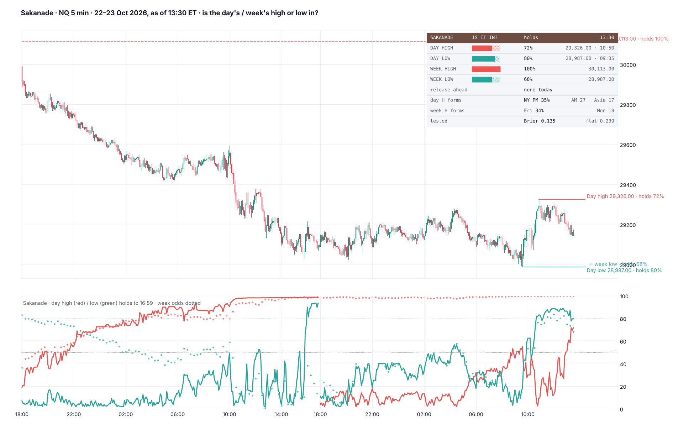

# Sakanade

**Is the high or low already in? Live odds that the day's high and low (18:00–17:00 ET) and the week's high and low hold to the close. The day odds come from gradient-boosted trees, trained on 1.1 million samples and run inside Pine. The odds are drawn on price at each extreme and bar by bar in a pane, with a card.**

TradingView indicator, Pine Script v6. Open source under the Mozilla Public License 2.0. *Not yet published on TradingView.*

Files: `Sakanade.pine` (the script), `TradingView_description.txt` (publication text), `research/` (sample building, model fits, the tree export to Pine, the port check; no market data included).

*Mock-up from NQ 5-minute candles, 22–23 Oct 2026 as of 13:30 ET, drawn by a Python port of the script; TradingView rendering will differ.*

**Sakanade** (逆撫, "Stroking the Wrong Way") is Shinji Hirako's zanpakutō in Bleach. Its release, *Sakasama no Sekai*, turns the opponent's world upside down: up is down, left is right, and the move that looks like a top may be the bottom. Every trader has bought "the low" that wasn't. This indicator answers, with tested numbers, whether the day's or the week's turn is already in.

*Odds that an extreme holds. It does not call direction.*

## What it shows

- **On price:**
  - the day's high and low, solid, each named with its odds: *Day high 29,326.00 · holds 72%*;
  - the week's high and low, dashed. When the week's extreme is the day's, its label reads *= week low · holds 68%*.
- **In the pane:** the chance the day's high (red) and low (green) hold to 16:59, bar by bar. The week's odds are dotted. Guides at 50% and 80%.
- **Card:**
  - the four extremes, each with a gauge, its odds, its price and the time it was set;
  - whether a CPI / NFP / FOMC release is still ahead today;
  - when the day's and the week's extremes tend to form;
  - the out-of-sample score.

  Mobile shows the four extremes only.
- **Alert:** the day's high or low odds rising through your level (80% by default).

Runs on intraday charts up to 1 hour.

## How the odds are made

### The day: gradient-boosted trees

- **Samples:** at the close of every 15-minute block of the trading day. NQ, ES and RTY 1-minute, 2018 – 23 Oct 2026, gives 911,630 samples in 2018–24 and 237,142 in 2025–26 (a high and a low at each mark).
- **Outcome:** the running high (low) is not exceeded before 16:59.
- **Inputs:**
  - **a Brownian touch probability:** the distance from the close to the extreme in daily ATR(14), over the square root of the volatility still to come today. That volatility comes from the intraday profile: the mean squared 1-minute range over the daily ATR, minute by minute from 18:00 (NQ + ES + RTY 2018–24, embedded in 5-minute steps);
  - the time; the range used; where price sits in the range; the extreme against PDH / PDL; the move since 18:00;
  - when the extreme was set and how long ago;
  - the next CPI / NFP (08:30) or FOMC (14:00) release still ahead today;
  - the weekday.
- **Model:** 50 trees of depth 3 (learning rate 0.2, subsample 0.7, at least 400 samples a leaf), fitted on 2018–24. Exported to Pine as nested conditions, one line per tree, and checked against scikit-learn to within 0.00002.

**Scored once on 2025 – Oct 2026:**

| Model | Brier | Log-loss |
|---|---|---|
| Flat rate | 0.239 | 0.671 |
| Brownian probability alone | 0.138 | 0.427 |
| **Gradient-boosted trees** | **0.135** | **0.420** |

- The trees beat the Brownian model by 0.007 log-loss (95% CI 0.003–0.011, day-clustered bootstrap), on each of NQ, ES and RTY.
- Calibration, predicted → actual: 6→6, 15→15, 25→26, 35→36, 45→47, 55→57, 65→66, 75→78, 85→88, 96→98%.
- The Brownian probability carries 94% of the trees' gain. The time of day, the extreme against PDH / PDL, the range used, when the extreme was set and a release ahead carry the rest.

### The week: the Brownian model

- **Samples:** every hour of the week, 237,388 in 2018–24 and 59,908 in 2025–26.
- **Model:** the same touch probability, over the volatility left in the week (the rest of today plus each full day to Friday). Calibrated: p = logistic(0.514 + 1.017·logit(2Φ(1.30·z) − 1)).
- **Score, 2025–26:** Brier 0.143 vs 0.248 for a flat rate.
- **Trees not used:** the same gradient-boosted trees did *not* beat it out of sample (−0.003 log-loss, CI −0.011 to 0.006), so they are left out.

### Where the extremes form (NQ + ES + RTY, 2018–24 → 2025–26)

| The day's final | Asia 18–00 | London 00–06 | 06:00–09:30 | NY AM 09:30–13:00 | NY PM 13:00–17:00 |
|---|---|---|---|---|---|
| High | 16.4 → 17.1% | 10.3 → 10.2% | 9.4 → 12.1% | 27.1 → 26.9% | 36.7 → 33.6% |
| Low | 22.5 → 23.8% | 11.0 → 12.9% | 8.7 → 6.5% | 28.7 → 29.2% | 29.2 → 27.6% |

| The week's | Mon | Tue | Wed | Thu | Fri |
|---|---|---|---|---|---|
| High (2018–24) | 18.3% | 18.9% | 12.0% | 16.9% | 33.9% |
| Low (2018–24) | 32.6% | 16.1% | 10.9% | 16.5% | 23.9% |

Extremes pile up at the two ends of each window, as a random walk's do (the arcsine law). No midweek day stands out the way the "Tuesday low of the week" teaching says. That is why the model leans on distance and time.

**The port check:** the Python port of the script's logic, run on 4,530 NQ samples from 2025–26 (1-minute), reproduced the trained model's odds to within 0.01 on 99.7% of them (max 0.03). The script counts the extreme's age in minutes; the test counted bars, and a few 1-minute bars are missing from the data.

## Notes

- The day is CME's trading day, 18:00–17:00 ET. Holidays and half days are not special-cased, and the week model counts weekdays to Friday.
- The release calendar covers 2025–27.

## Credits

ICT (Michael J. Huddleston) teaches the time of day and the weekly profiles in which highs and lows form. The model is built from scratch. Not affiliated with or endorsed by ICT.

## Research

`research/t13_build.py` builds the samples; `t13_fit.py` fits and scores the models; `export_gbm.py` writes the trees as Pine and checks them; `gen_pine.py` assembles the script; `t14_when.py` gives where the extremes form; `mock_sk.py` is the port, the port check and the mock. `t12_*` is the first pass, with per-market profiles. They read 1-minute arrays from the original workspace. No market data is included.

## License

Mozilla Public License 2.0.
