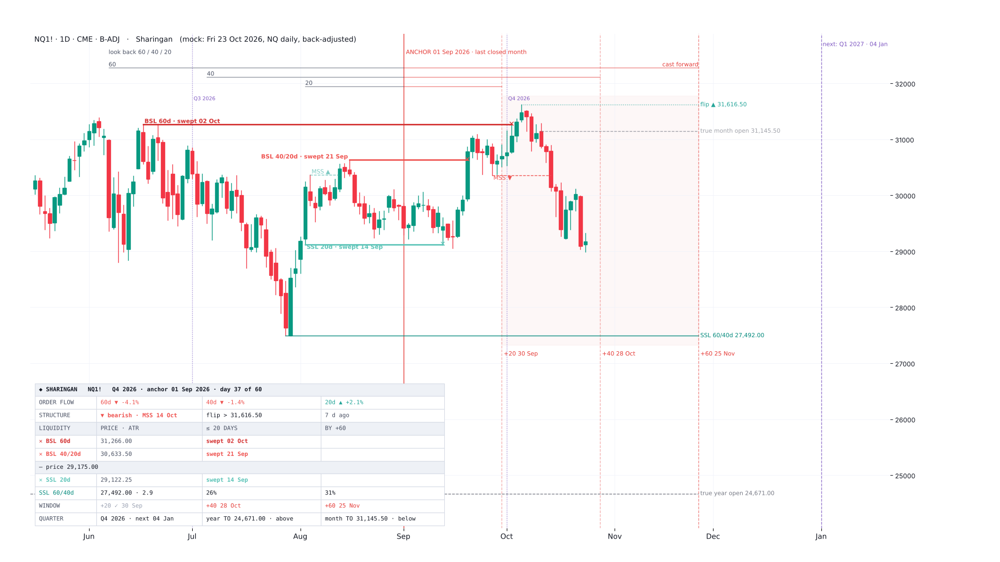
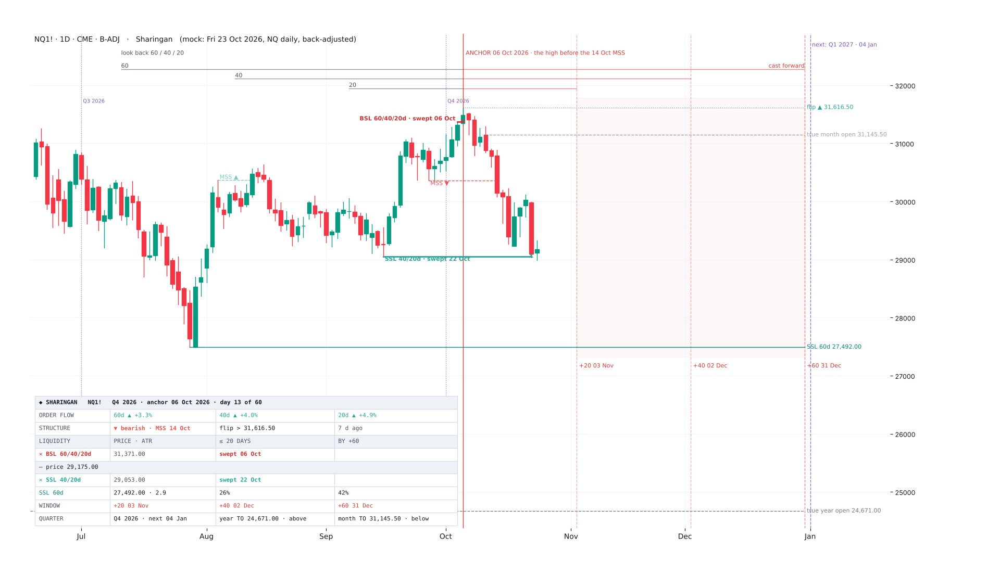
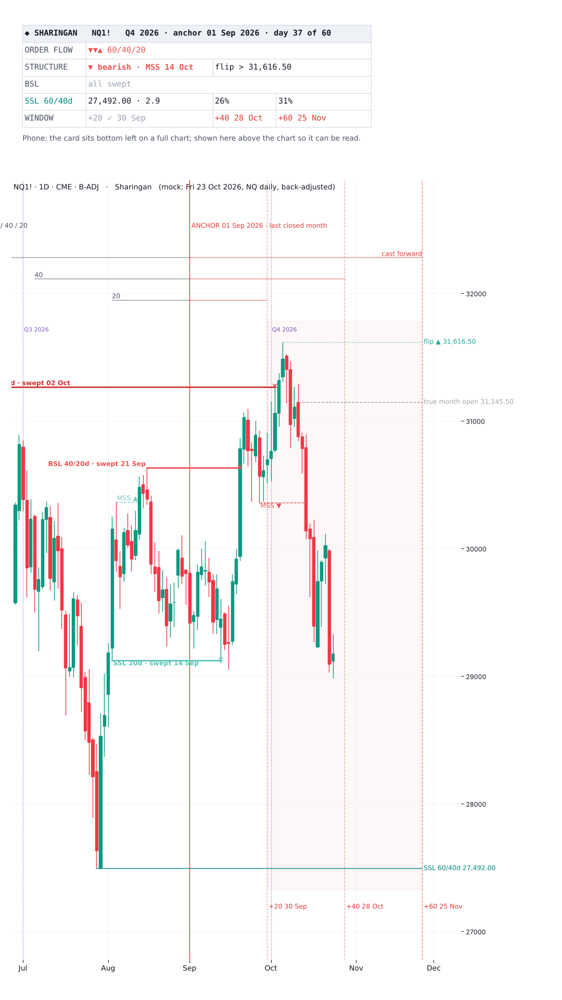
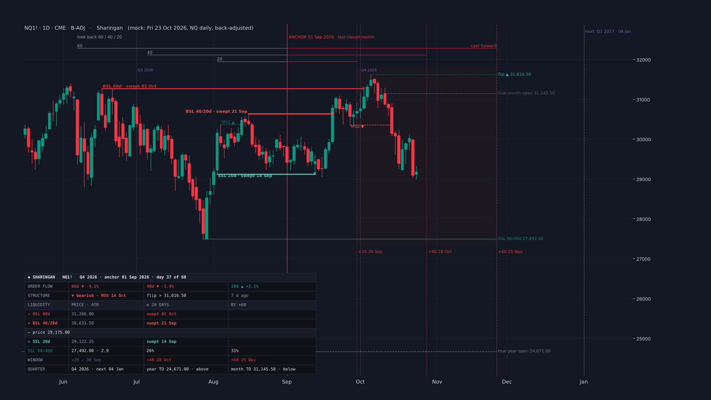

# Sharingan

**ICT's quarterly shift and IPDA data ranges on the chart: the 60 / 40 / 20-day look back as buy-side and sell-side liquidity, the +20 / +40 / +60 cast forward, daily market structure, the Quarterly Theory quarters and true opens, and the tested odds of each level**

TradingView indicator, Pine Script v6. Open source under the Mozilla Public License 2.0. *Not yet published on TradingView.*

Files: `Sharingan.pine` (the script), `TradingView_description.txt` (publication text), `research/` (the tests behind the odds; no market data included).

*Mock-ups from NQ daily data (back-adjusted), 23 Oct 2026; TradingView rendering will differ.*

**Sharingan** (写輪眼, "Copy Wheel Eye") is named for the eye that reads an opponent's past movement to anticipate the next. It reads the last three months to frame the next three, as ICT teaches quarterly shifts and IPDA data ranges (2017 Mentorship, Month 05).

*A map of where the liquidity rests and when ICT expects the next shift. It does not call direction.*

## What it draws

- **The anchor**, either of these:
  - the first trading day of the last closed month (ICT's default; on 6 Jan 2017 → 1 Dec 2016);
  - the last daily structure shift: the high or low a daily close beyond the last opposite swing came from (the calibrated anchor).
  - **Both** draws the second anchor and its marks too.
- **The look back:** the 60, 40 and 20 trading days left of the anchor.
  - Each window's high is buy-side liquidity (BSL), its low sell-side (SSL).
  - **Standing:** a solid line run right to +60, with its name and price, e.g. *SSL 60/40d 27,492.00*.
  - **Swept:** a bold line that stops at the candle that took it, marked ✕ there, and named with the date at its origin, e.g. *BSL 60d · swept 02 Oct*. The name sits above a high or below a low, on the side where no candle reached it, so it never covers price.
  - Identical levels are merged, e.g. *60/40d*.
  - Brackets above price mark the three windows, as on ICT's slides.
- **Market structure (daily):**
  - the last two shifts (MSS ▲ / ▼): dashed from the swing a daily close broke to the candle that closed beyond it;
  - the flip level: the swing a daily close must clear to shift it back, dotted and run right.
- **Quarterly Theory:**
  - the true year open (the open of the first Monday of April, the start of the year's Q2) and the true month open (the open of the second Monday), dashed and run right;
  - the quarter's name on each divider (*Q4 2026*).
- **The cast forward:** +20, +40 and +60 trading days right of the anchor.
  - The +20 → +60 window is shaded, with brackets above price.
  - Future dates skip weekends and CME equity holidays.
- **Quarterly dividers (Q1–Q4):** Jan / Apr / Jul / Oct, or ICT's Dec / Mar / Jun / Sep, plus the next one ahead.

## Card

- **Header:** the quarter, the anchor and the day count (*Q4 2026 · anchor 01 Sep 2026 · day 37 of 60*).
- **ORDER FLOW:** the net change over the 60 / 40 / 20 days left of the anchor. ICT: trading higher → frame off the low; lower → frame off the high.
- **STRUCTURE:** bullish or bearish, the last MSS and how many days ago, and the flip level (*flip > 31,616.50*).
- **LIQUIDITY:** buy-side levels above the price row, sell-side below, the way they sit on the chart.
  - Standing: the price, the distance from the last close in daily ATR(14), and the tested chance it trades within 20 trading days and by +60 (the window's end).
  - Swept: ✕ and the date, in bold.
- **WINDOW:** the +20 / +40 / +60 dates, ✓ once passed.
- **QUARTER:** the quarter and the next one, and whether price is above or below the true year and month opens.
- **Mobile** keeps the header, order flow, structure, the nearest standing BSL and SSL, and the window.

## Tested (NQ, ES, YM, RTY daily 2010–26)

**What held: the level odds.**
- **Inputs.** The chance a look-back high or low trades comes from its distance in ATR(14) and the days left. The model is p = logistic(a + b·logit(2Φ(−d / (κ√h)))), with highs and lows fit separately.
- **Walk-forward 2014–26** (each year fit on the years before), predicted → actual:
  - within 20 days: 3→4% · 19→20% · 39→39% · 59→58% · 79→77% · 93→95%;
  - by +60: 3→5% · 19→22% · 39→41% · 60→60% · 80→77% · 94→92%.
- **Single years** ran 0.7–1.3× the average; a trending year takes fewer levels on one side.
- **For scale,** within 20 days:
  - a high 1 ATR away 72%, 2 ATR 49%, 3 ATR 29%;
  - a low 62%, 39%, 25%.

**What the timing claims came to.** These are shown in the tooltips, not as signals.
- **Turning points** came 5.3–6.6 times a year, the rate a random walk with the same volatility gives (5.8–6.5). There is no 3–4-month rhythm beyond chance.
- **The +20 / +40 / +60 marks.** Within ±2 days of them sat 28–31% of a 60-day window's highs and lows after a month anchor, against 25–28% by chance.
- **The window's ends.** A window's high and low pile up at its two ends by chance (the arcsine law): days 0–2 and 58–60 hold about a third. That is why the +60 mark so often "nails" the extreme.
- **Structure shifts** came 8.5–10.3 a year, median 20–21.5 days apart (random walk 20.7–21.6). The next one broke within 20–60 days of the last one's extreme 54–61% of the time (random walk 52–57%). So MSS and the flip level are drawn to frame the liquidity, not to time the next shift.
- **Order flow:**
  - after a 60-day up move the 20-day low was taken first 23–30% of the time (random walk 27–32%);
  - after a down move the 20-day high first 51–57% (random walk 44–48%).
  - Buy-side goes first more often either way (the index drift).
- **Quarter starts** saw turning points on 2.4–4.3% of days against a 2.1–2.6% base. That does not survive correcting for the number of tests.
- **Quarterly Theory, the month:**
  - in months that closed up, the low came in Q2 (the second week) 13–17% of the time, against 17–18% by chance;
  - Judas: Q1's range broke after the true month open and the month then closed on the other side of it 24–39% of the time, against 36–38%.
- **Quarterly Theory, the year:** 16 years is too few to test. The true opens are drawn as references, not scored.

Daily fair value gaps are not drawn here: they live in Mangekyō.

## Why the name

**Sharingan** (写輪眼, the *Copy Wheel Eye*) is the Uchiha clan's eye: it reads an opponent's movement so closely that it can copy a technique and see the next strike before it lands. Fully awakened, it shows three tomoe.

Here the three tomoe are the three look backs, 60, 40 and 20 trading days: what price has already done. The cast forward is the copy, the same 20 / 40 / 60 days projected ahead of the anchor, where the next shift is expected. The eye reads; it does not decide. Neither does this indicator. Its next stage, [Mangekyō](../mangekyo/), turns the same gaze onto the daily candles inside the quarter.

## Credits

Quarterly shift, IPDA data range, look-back and cast-forward, buy-side and sell-side liquidity and market-structure shift concepts are taught by ICT (Michael J. Huddleston). Quarterly Theory (the Q1–Q4 cycles and true opens) is taught by Daye. Not affiliated with or endorsed by either.

## Licence

Mozilla Public License 2.0. © Unclehk2000. *Historical frequencies, not guarantees. Nothing here is financial advice.*
