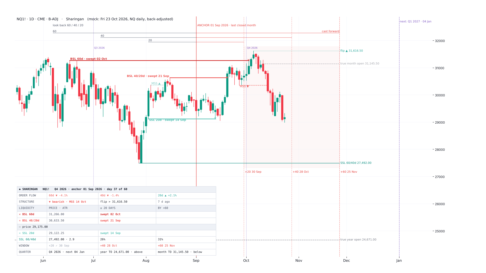
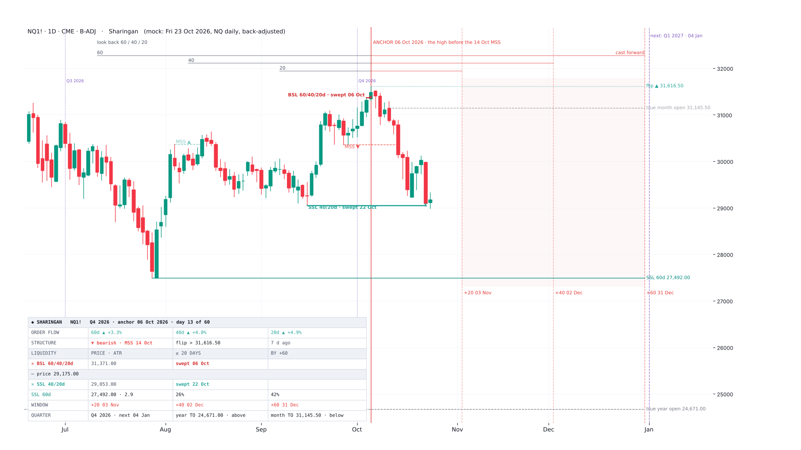
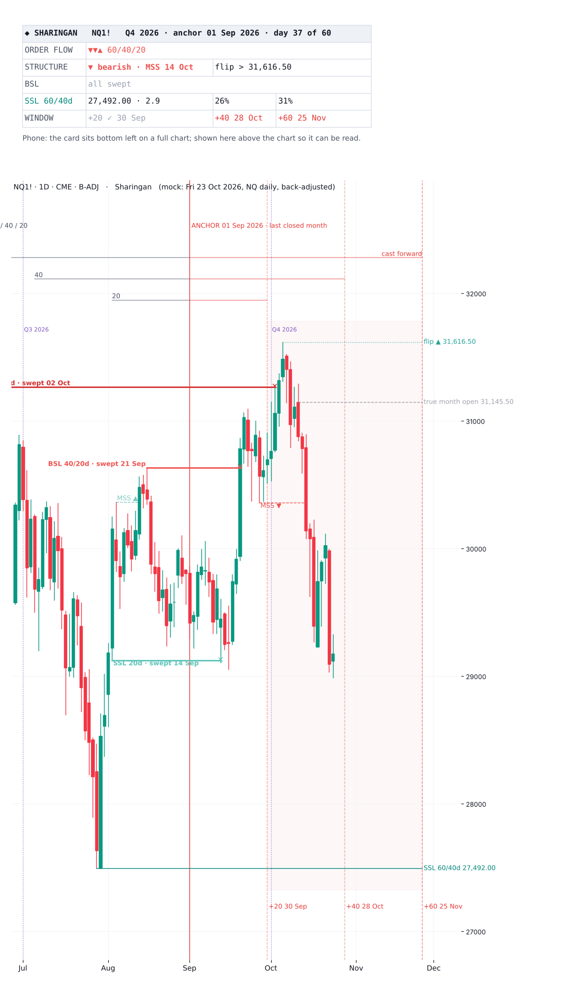
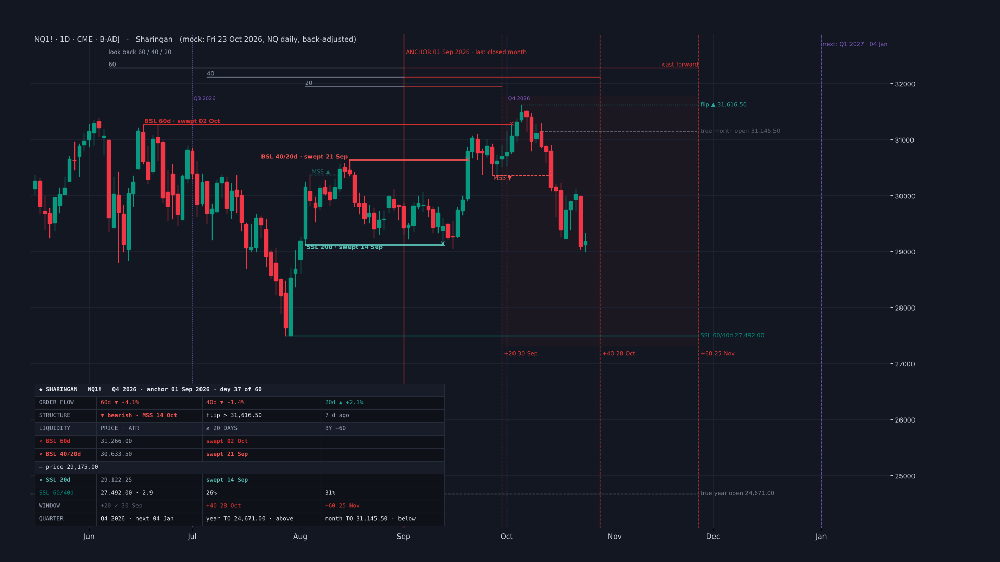
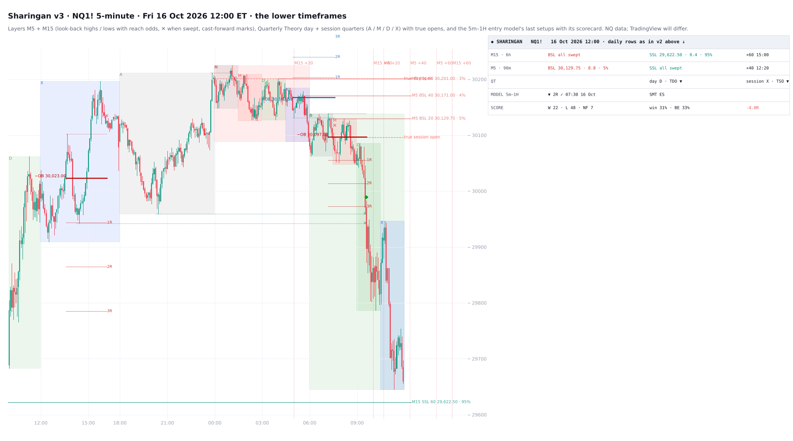
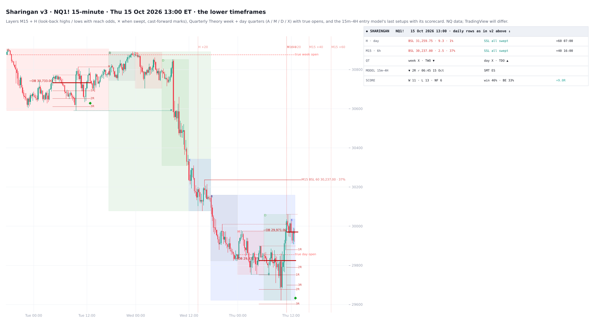
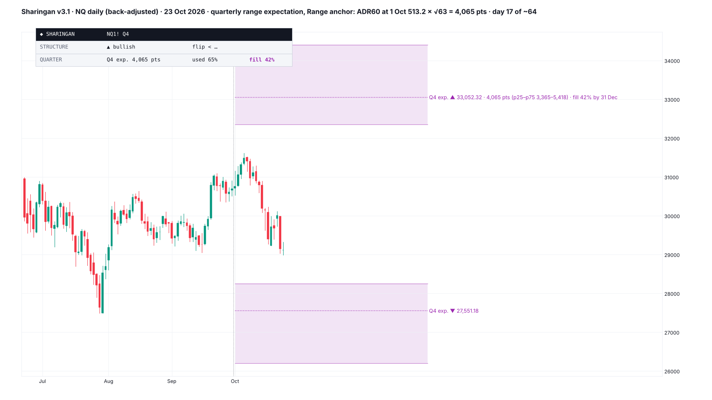
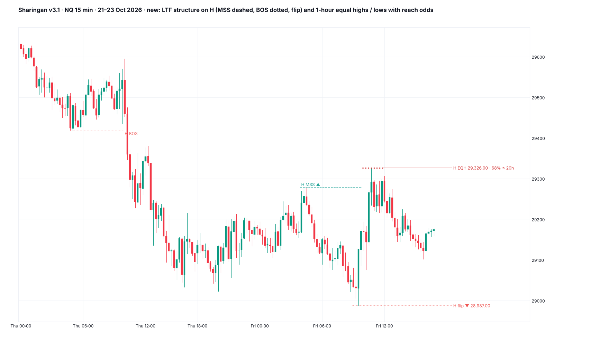

# Sharingan

**ICT's quarterly shift and IPDA data ranges on the chart, from the daily down to the 1-minute: the 60 / 40 / 20 look back as buy-side and sell-side liquidity, the +20 / +40 / +60 cast forward, daily market structure, Quarterly Theory quarters and true opens, an entry model with a live scorecard, and the tested odds of each level**

TradingView indicator, Pine Script v6. Open source under the Mozilla Public License 2.0. *Not yet published on TradingView.*

Files: `Sharingan.pine` (the script), `TradingView_description.txt` (publication text), `research/` (the tests behind the odds; no market data included).

*Mock-ups from NQ daily data (back-adjusted), 23 Oct 2026; TradingView rendering will differ.*

**Sharingan** (写輪眼, "Copy Wheel Eye") is named for the eye that reads an opponent's past movement to anticipate the next. It reads the last three months to frame the next three, as ICT teaches quarterly shifts and IPDA data ranges (2017 Mentorship, Month 05).

*A map of where the liquidity rests and when ICT expects the next shift. It does not call direction.*

## What it draws

- **The anchor**, either of these:
  - the first trading day of the last closed month (ICT's default; on 6 Jan 2017 → 1 Dec 2016);
  - the last daily structure shift: the high or low a daily close beyond the last opposite swing came from (the calibrated anchor).
  - **Both** draws the second anchor and its marks too.
- **The look back:** the 60, 40 and 20 trading days left of the anchor.
  - Each window's high is buy-side liquidity (BSL), its low sell-side (SSL).
  - **Standing:** a solid line run right to +60, with its name and price, e.g. *SSL 60/40d 27,492.00*.
  - **Swept:** a bold line that stops at the candle that took it, marked ✕ there, and named with the date at its origin, e.g. *BSL 60d · swept 02 Oct*. The name sits above a high or below a low, on the side where no candle reached it, so it never covers price.
  - Identical levels are merged, e.g. *60/40d*.
  - Brackets above price mark the three windows, as on ICT's slides.
- **Market structure (daily):**
  - the last two shifts (MSS ▲ / ▼): dashed from the swing a daily close broke to the candle that closed beyond it;
  - the flip level: the swing a daily close must clear to shift it back, dotted and run right.
- **Quarterly Theory:**
  - the true year open (the open of the first Monday of April, the start of the year's Q2) and the true month open (the open of the second Monday), dashed and run right;
  - the quarter's name on each divider (*Q4 2026*).
- **The cast forward:** +20, +40 and +60 trading days right of the anchor.
  - The +20 → +60 window is shaded, with brackets above price.
  - Future dates skip weekends and CME equity holidays.
- **Quarterly dividers (Q1–Q4):** Jan / Apr / Jul / Oct, or ICT's Dec / Mar / Jun / Sep, plus the next one ahead.

## v3: the lower timeframes

*Mock-ups from NQ minute data (5-minute, Fri 16 Oct 2026 12:00; 15-minute, Thu 15 Oct 2026 13:00); TradingView rendering will differ.*

**LTF IPDA layers.** ICT's 60 / 40 / 20 carried down the Quarterly Theory fractal. Each layer keeps the counts on its own unit and anchors on the first unit of its last closed period:

| Layer | Unit | Anchor (last closed) | Look back / cast forward |
|---|---|---|---|
| H | 1 hour | trading day (18:00–17:00) | 20 / 40 / 60 hours |
| M15 | 15 minutes | 6-hour session (18, 00, 06, 12) | 5 / 10 / 15 hours |
| M5 | 5 minutes | 90-minute quarter | 100 / 200 / 300 minutes |
| M1 | 1 minute | 22.5-minute quarter | 20 / 40 / 60 minutes |

- Standing highs (BSL) and lows (SSL) are run right with their chance of trading within 20 units. Swept ones are dotted to the candle that took them, with ✕ there.
- The +20 / +40 / +60 marks are dotted verticals.
- Auto picks the layers from the chart: 1 minute → M1 + M5; 2–5 → M5 + M15; 6–15 → M15 + H; up to 1 hour → H.

**Quarterly Theory cycles (Daye).** The week (Mon–Thu), day (four 6-hour quarters) and session (four 90-minute quarters), boxed as A / M / D / X with their true opens.

**Entry model with a live scorecard.** Studied from the "Forever" scripts and written from scratch, at 1m–15m, 5m–1H or 15m–4H.
- The chain: an HTF FVG; a swing swept by a ≥ 50%-body candle (the order block); an SMT divergence with the pair from one of the gap's candles; a close back through the order block.
- The trade: a limit at the order block, stop at the SMT extreme, R projections and the ERL.
- On the chart: backtest marks (◆ target, ✕ stop, orange ◆ no fill, + ERL) and alerts.
- The card's SCORE row counts wins, losses and no-fills on the loaded bars against break-even.

### Tested (NQ, ES, RTY 1-minute, 2018 – Oct 2026; fit 2018–24, scored 2025–26)

The null is the same bars with each move's direction flipped at random. It keeps the volatility and the time of day and removes direction.

**Held: the reach odds.** Within 20 units, a standing level 0.5–1 ATR away traded 76–80% of the time, 1–2 ATR 52–62%, 2–3 ATR 29–43%, 3–5 ATR 12–24%. Brier score on 2025–26: 0.150 → 0.117 on M15 (H 0.130 → 0.091, M5 0.146 → 0.110, M1 0.143 → 0.111). Calibrated within about 5 points up to 80%; high above that.

**Not found:**

| Claim | Real | Null |
|---|---|---|
| Levels as magnets (vs a decoy the same distance on the other side) | within ±1 point on every layer | — |
| Highs / lows within 2 units of +20 / +40 or at the end | 22–34% | 23–37% |
| Order flow picks the first side (M5, after up / down moves) | 57.3% / 51.0% | 55.8% / 51.3% |
| QT: Q2 holds the counter-extreme (week / day / session) | 27.5 / 19.1 / 26.2% | 25.8 / 20.0 / 26.1% |
| QT: Judas (week / day / session) | 37.2 / 40.4 / 35.9% | 36.8 / 41.4 / 36.0% |
| Entry model, 2R first (1m–15m / 5m–1H / 15m–4H; ~57,000 fills) | 34.3 / 35.4 / 34.5% | 33.8 / 33.8 / 33.5% |
| SMT at sweeps: reversal (H / M15 / M5), with vs without SMT | 53.6 / 61.4 / 60.2% | 54.8 / 63.0 / 61.5% |

The entry model makes about +0.03R a trade before costs (2025–26: +0.6, −0.4, −1.5 points against the null). It is drawn with its scorecard so it can be watched, not as an edge. Scripts: `research/sh3/`.

## v3.1: structure on the lower timeframes, equal levels, the quarter's expected range

- **LTF structure.** Market structure on a layer's own unit, in the daily structure's style: the last two shifts (MSS, dashed, from the swing broken to the close beyond it), the last break of structure with the trend (BOS, dotted) and the flip level. Default: the coarser of the chart's two layers (H on 6–60 minute charts, M15 on 2–5 minutes, M5 on 1 minute); "Both layers" draws each, named.
- **Equal highs / lows on H.** Two 3-bar 1-hour swing highs (lows) within 0.2 × the median ATR(14), both standing (studied from fadizeidan's Institutional Order Flow, written from scratch). Tested on NQ, ES and RTY 2018–26 against single swings at the same distance: reached within 20 hours 77.3% vs 75.3% on 2025–26 (+2.0 ± 0.8 points; 2018–24 +2.5 ± 0.4). On 5 and 15 minutes they were reached slightly less often than single swings (−0.9, −0.6), so they are drawn on H only. Label odds: reach within 20 hours at the current distance (logit 1.120 − 1.177 · ln(distance in 1-hour ATR)).
- **Hide LTF levels beyond 2 / 4 / 8 ATR** of the layer's unit: a declutter switch (off by default).
- **Quarterly range expectation.** Expected range = 1.0 × ADR60 at the quarter's first day × √63 (median; p25 0.83×, p75 1.33×), fitted on NQ, ES and RTY daily data 2010–21 (144 quarters). On 2022–26 (57 quarters) 30% finished below p25, 47% below p50 and 70% below p75. Drawn as tubes: the quarter's low + the expected range and its high − the expected range (Range anchor, moves with the extremes), or the open ± half of it (Open anchor). The card's QUARTER row shows the range used and the fill odds: the chance the quarter's range reaches the expected range by quarter end, by share of the quarter gone and of the range used; Brier 0.148 on 2022–26 against 0.250 for the base rate. It is a range, not a direction.
- **Entry model off by default.** Its tests found no edge (2R hit 34.3–35.4% against 33.5–33.8% for random entries, ≈ +0.03R before costs). It is still there, with its scorecard.

## Card

- **Header:** the quarter, the anchor and the day count (*Q4 2026 · anchor 01 Sep 2026 · day 37 of 60*).
- **ORDER FLOW:** the net change over the 60 / 40 / 20 days left of the anchor. ICT: trading higher → frame off the low; lower → frame off the high.
- **STRUCTURE:** bullish or bearish, the last MSS and how many days ago, and the flip level (*flip > 31,616.50*).
- **LIQUIDITY:** buy-side levels above the price row, sell-side below, the way they sit on the chart.
  - Standing: the price, the distance from the last close in daily ATR(14), and the tested chance it trades within 20 trading days and by +60 (the window's end).
  - Swept: ✕ and the date, in bold.
- **WINDOW:** the +20 / +40 / +60 dates, ✓ once passed.
- **QUARTER:** the quarter and the next one, and whether price is above or below the true year and month opens.
- **Mobile** keeps the header, order flow, structure, the nearest standing BSL and SSL, and the window.

## Tested (NQ, ES, YM, RTY daily 2010–26)

**What held: the level odds.**
- **Inputs.** The chance a look-back high or low trades comes from its distance in ATR(14) and the days left. The model is p = logistic(a + b·logit(2Φ(−d / (κ√h)))), with highs and lows fit separately.
- **Walk-forward 2014–26** (each year fit on the years before), predicted → actual:
  - within 20 days: 3→4% · 19→20% · 39→39% · 59→58% · 79→77% · 93→95%;
  - by +60: 3→5% · 19→22% · 39→41% · 60→60% · 80→77% · 94→92%.
- **Single years** ran 0.7–1.3× the average; a trending year takes fewer levels on one side.
- **For scale,** within 20 days:
  - a high 1 ATR away 72%, 2 ATR 49%, 3 ATR 29%;
  - a low 62%, 39%, 25%.

**What the timing claims came to.** These are shown in the tooltips, not as signals.
- **Turning points** came 5.3–6.6 times a year, the rate a random walk with the same volatility gives (5.8–6.5). There is no 3–4-month rhythm beyond chance.
- **The +20 / +40 / +60 marks.** Within ±2 days of them sat 28–31% of a 60-day window's highs and lows after a month anchor, against 25–28% by chance.
- **The window's ends.** A window's high and low pile up at its two ends by chance (the arcsine law): days 0–2 and 58–60 hold about a third. That is why the +60 mark so often "nails" the extreme.
- **Structure shifts** came 8.5–10.3 a year, median 20–21.5 days apart (random walk 20.7–21.6). The next one broke within 20–60 days of the last one's extreme 54–61% of the time (random walk 52–57%). So MSS and the flip level are drawn to frame the liquidity, not to time the next shift.
- **Order flow:**
  - after a 60-day up move the 20-day low was taken first 23–30% of the time (random walk 27–32%);
  - after a down move the 20-day high first 51–57% (random walk 44–48%).
  - Buy-side goes first more often either way (the index drift).
- **Quarter starts** saw turning points on 2.4–4.3% of days against a 2.1–2.6% base. That does not survive correcting for the number of tests.
- **Quarterly Theory, the month:**
  - in months that closed up, the low came in Q2 (the second week) 13–17% of the time, against 17–18% by chance;
  - Judas: Q1's range broke after the true month open and the month then closed on the other side of it 24–39% of the time, against 36–38%.
- **Quarterly Theory, the year:** 16 years is too few to test. The true opens are drawn as references, not scored.

Daily fair value gaps are not drawn here: they live in Mangekyō.

## Why the name

**Sharingan** (写輪眼, the *Copy Wheel Eye*) is the Uchiha clan's eye: it reads an opponent's movement so closely that it can copy a technique and see the next strike before it lands. Fully awakened, it shows three tomoe.

Here the three tomoe are the three look backs, 60, 40 and 20 trading days: what price has already done. The cast forward is the copy, the same 20 / 40 / 60 days projected ahead of the anchor, where the next shift is expected. The eye reads; it does not decide. Neither does this indicator. Its next stage, [Mangekyō](../mangekyo/), turns the same gaze onto the daily candles inside the quarter.

v3 is the copy ninja's habit. Kakashi carried a single Sharingan and copied a thousand techniques, and this version copies the daily look back down the fractal to the hour, the session and the minute. It copies an entry model too, the way the eye copies any jutsu it sees. But a copied technique is only as good as the original, so the scorecard sits beside it: the copy runs at the rate of a coin flip.

## Credits

Quarterly shift, IPDA data range, look-back and cast-forward, buy-side and sell-side liquidity and market-structure shift concepts are taught by ICT (Michael J. Huddleston). Quarterly Theory (the Q1–Q4 cycles, the A / M / D / X quarters and true opens) is taught by Daye. The v3 entry model was studied from the "Forever" scripts and the quarter boxes from "Daye Quarterly Theory" by CantoLab; both are written from scratch. Not affiliated with or endorsed by any of them.

## Licence

Mozilla Public License 2.0. © Unclehk2000. *Historical frequencies, not guarantees. Nothing here is financial advice.*
