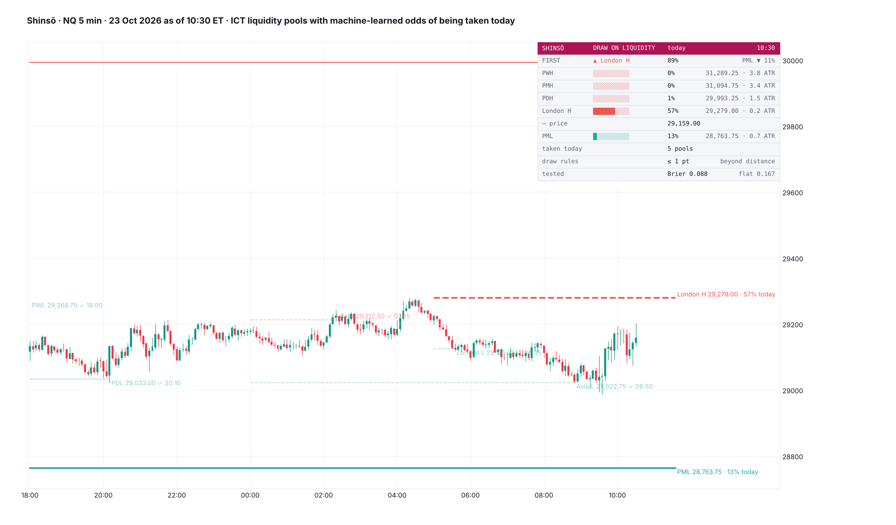

# Shinsō

**Draw on liquidity, with machine-learned odds. ICT's liquidity pools (PDH / PDL, PWH / PWL, PMH / PML, the Asia and London ranges) each carry the chance they trade before 16:59 today, and the nearest buy-side and sell-side pools carry the odds of which goes first. Both models are gradient-boosted trees run inside Pine.**

TradingView indicator, Pine Script v6. Open source under the Mozilla Public License 2.0. *Not yet published on TradingView.*

Files: `Shinso.pine` (the script), `TradingView_description.txt` (publication text), `research/` (samples, fits, the tree export, the port check; no market data included).

*Mock-up from NQ 5-minute candles, 23 Oct 2026 as of 10:30 ET, drawn by a Python port of the script; TradingView rendering will differ.*

**Shinsō** (神鎗, "God Spear") is Gin Ichimaru's zanpakutō in Bleach. It extends in an instant to strike a target far away; its bankai, Kamishini no Yari, reaches thirteen kilometres. ICT's "draw on liquidity" is the target price is reaching for. This indicator puts a tested number on how far each target is in reach today.

*Odds that each pool is reached. It does not call direction.*

## What it shows

- **Pools on price**, each named with its odds: *London H 29,279.00 · 57% today*.
  - Solid: the previous day's, week's and month's highs and lows.
  - Dashed: the Asia (20:00–00:00 ET) and London (02:00–05:00) ranges, live once the session ends.
  - The nearest buy-side and sell-side pools are drawn thicker.
  - Taken pools fade and stop at the candle that took them (✓ and the time), or can be hidden.
- **Card:**
  - *FIRST*: the nearest buy-side pool against the nearest sell-side pool, with the odds of each trading first;
  - every live pool in price order, with a gauge, its odds, its price and its distance in daily ATR;
  - pools taken today; the draw-rule test; the out-of-sample score.

  Mobile shows the race and the two nearest pools.
- **Alert:** a pool taken.
- All pools reset at 18:00 ET. Intraday charts up to 1 hour.

## How the odds are made

### Pools

- **Samples:** every 15 minutes for every live, untouched pool. NQ, ES and RTY 1-minute, 2018 – 23 Oct 2026, gives 2,326,239 samples in 2018–24 and 598,185 in 2025–26.
- **Outcome:** the pool trades before 16:59.
- **Inputs:**
  - **a Brownian touch probability:** the distance in daily ATR(14) over the square root of the volatility still to come today, from the intraday profile;
  - the pool's type and side; the time;
  - how many live pools sit between price and it, and other pools stacked within 0.15 ATR;
  - how many pools on each side are already taken today;
  - the day's move toward the pool;
  - a CPI / NFP / FOMC release still ahead; the weekday.
- **Model:** 50 gradient-boosted trees of depth 3, exported to Pine.

| Pools, 2025 – Oct 2026 | Brier | Log-loss |
|---|---|---|
| Flat rate | 0.167 | 0.517 |
| Brownian distance-and-time | 0.090 | 0.280 |
| **Gradient-boosted trees** | **0.088** | **0.276** |

- Gain 0.004 log-loss (95% CI 0.002–0.007, day-clustered bootstrap), on NQ, ES and RTY each.
- Calibration: 2→2, 15→12, 25→23, 35→32, 45→42, 55→55, 65→65, 75→75, 85→85, 93→93%.
- Taken by 16:59, per live pool sample: PDH / PDL 29%, PWH / PWL 11%, PMH / PML 5%, Asia 57%, London 50%.

### The race: buy-side or sell-side first

- **Samples:** at each 15-minute mark, the nearest live pool above and the nearest below; whichever trades first today. 261,109 races in 2018–24 and 66,417 in 2025–26.
- **Baseline:** price's position between the two pools (the gambler's-ruin odds) is already informative: Brier 0.168 against 0.249 for a flat rate. It is a little too timid at the edges (7→2%, 94→97%).
- **Trees** (40, depth 3) on that position, the pools' types, how many are taken on each side, the day's move and the time:
  - Brier 0.166 (gain 0.007 log-loss, 95% CI 0.002–0.011);
  - calibrated 6→5, 15→14, 25→24, 35→32, 45→41, 55→51, 65→61, 75→75, 85→85, 94→96%.

### ICT's draw reasoning

Tested against the distance-and-time odds on 2025–26: the outcome minus the Brownian prediction, errors clustered by day.

| Reading | Beyond distance and time |
|---|---|
| The other side already taken today | −0.3 ± 0.5 points |
| Nothing taken on the other side | −1.0 ± 0.8 |
| Another pool stacked within 0.15 ATR | +0.2 ± 1.3 |
| The pool in the direction of the day's move | −0.7 ± 0.7 |
| Against the day's move | −0.3 ± 0.6 |

None of these moves the odds. Which pool gets taken is, overwhelmingly, a question of how far it is and how much of the day is left. The trees keep these inputs for the small amount they add together, and the card says so.

**The port check:** the Python port of the script's logic (pool tracking, live and taken, every input), run on 9,732 NQ pool samples from 2025–26, reproduced the trained model's odds to within 0.01 on 99.9% of them (max 0.04).

## Credits

Liquidity pools, buy-side and sell-side liquidity, the draw on liquidity and the killzone ranges are taught by ICT (Michael J. Huddleston). The models are built from scratch. Not affiliated with or endorsed by ICT.

## Research

`research/t15_build.py` builds the pool and race samples; `t15_fit.py` fits, scores and tests the draw readings; `export2.py` writes both tree models as Pine; `gen_pine.py` assembles the script; `mock_sn.py` is the port, the port check and the mock. They use the intraday volatility profile from Sakanade's research. No market data is included.

## License

Mozilla Public License 2.0.
