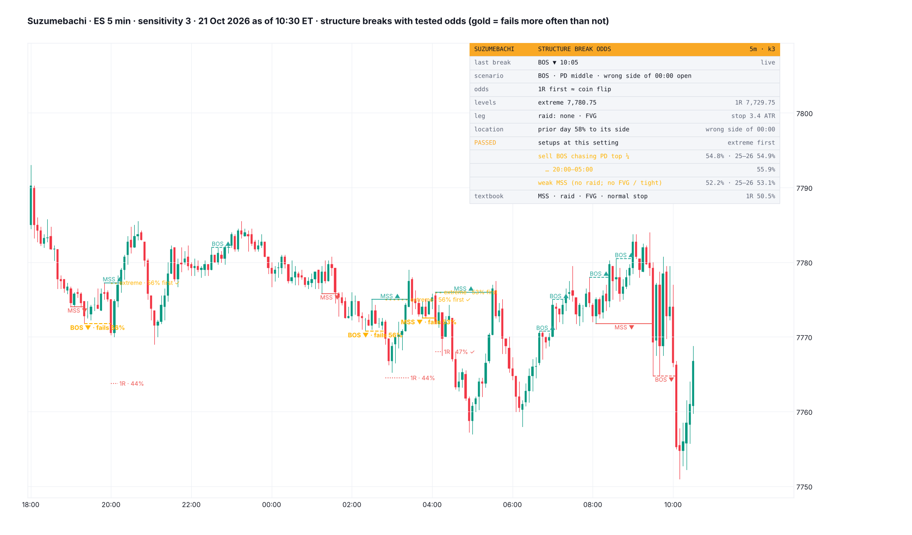

# Suzumebachi

**Market structure at the sensitivity you choose, with every break of structure (MSS or BOS) labelled by its scenario and its tested odds. Trained on ES and YM; checked on 2025–26 and on NQ and RTY. Every scenario that passed is a break that fails more often than it works. The textbook MSS (raid + FVG) is a coin flip.**

TradingView indicator, Pine Script v6. Open source under the Mozilla Public License 2.0. *Not yet published on TradingView.*

Files: `Suzumebachi.pine` (the script), `TradingView_description.txt` (publication text), `research/` (event build, scans, scenario table, the port check; no market data included).

*Mock-up from ES 5-minute candles, sensitivity 3, 21 Oct 2026 as of 10:30 ET, drawn by a Python port of the script; TradingView rendering will differ. The two gold sell BOS (20:00 and 02:50) chased the top of the prior day's range; both went back to their extreme first.*

**Suzumebachi** (雀蜂, "Hornet") is Soi Fon's zanpakutō in Bleach. Its power, Nigeki Kessatsu ("death in two steps"), needs two stings in the same spot: the first leaves a mark, the second kills. ICT's market structure shift asks for two strikes as well: a raid on liquidity, then a displacement. Suzumebachi tests both. A break with neither fails more often than it works. A break with both is a coin flip.

*It rates breaks. It does not call direction on its own.*

## What it shows

- **Structure** at sensitivity 2 (internal), 3, 5 or 8 (swing): a swing high needs k lower candles each side, confirmed k candles later.
- **Every break:** a line from the broken swing to the break candle.
  - MSS (solid) when it turns the trend, BOS (dashed) when it continues it.
  - The tooltip gives its scenario and odds:
    - the raid: the first trade through PWH/PWL, PDH/PDL, the Asia or London high/low inside this leg, a new day extreme, the prior swing, or none;
    - an FVG in the break leg;
    - the stop in 14-candle average ranges (under 1.5 is tight);
    - where it closed in the prior day's range, and against the midnight open.
- **Breaks that passed** are gold and read *fails 56%*. Optional dotted lines run to the leg extreme and to 1R until one is touched (✓).
- **Card:**
  - the last break, with its scenario, odds and levels;
  - the setups that passed at this setting, with their 2025–26 figures;
  - the textbook MSS for comparison.

  Mobile shows the last break and its odds.
- **Alert:** a break in a setup that passed.
- **Where the odds apply:** 5-minute (sensitivity 2, 3, 5, 8) and 15-minute (2, 3) charts. Elsewhere breaks are drawn without odds.

## How it was tested

- **Data:** ES, YM, NQ and RTY 1-minute, 2018 – 23 Oct 2026, built into 5- and 15-minute structure at six settings: **739,504 breaks**.
- **Split:**
  - **trained / discovered on ES + YM 2018–24 only;**
  - checked on 2025 – Oct 2026 (all four markets; the only data independent in time) and on NQ + RTY 2018–24.
- **The 1R race:** from the break candle's close, does price reach 1R in the break's direction before it returns to the leg extreme (1R = the distance to the extreme)?
  - Raced on 1-minute bars to 16:59.
  - A race still open at 16:59 is scored by its mark-to-market R.
  - **Under any driftless price this is exactly 50%, whatever the volatility**, so it is a coin-flip test that volatility cannot fake.
- **The suite's rule** for anything on the card:
  - p < 0.05 with errors clustered by day;
  - the same sign in 2018–24 and 2025–26;
  - the same sign on ES, YM, NQ and RTY.

### Base rates: structure breaks alone are coin flips

| Setting | MSS, 1R first | BOS, 1R first |
|---|---|---|
| 5m · 2 | 49.4% | 49.0% |
| 5m · 3 | 49.6% | 49.1% |
| 5m · 5 | 50.1% | 49.1% |
| 5m · 8 | 50.6% | 49.6% |
| 15m · 2 | 50.6% | 49.3% |
| 15m · 3 | 50.5% | 49.6% |

2018–26, four markets, ± 0.2–0.4.

### Scenarios

- **One context at a time:** 641 tests (raid, SMT, FVG, displacement, stop size, killzone, prior-day octant, 1H dealing-range octant, 1H and daily trend, midnight / 18:00 / weekly open, speed).
  - 165 were significant on ES + YM 2018–24.
  - **8 held in 2025–26** with the same sign on NQ + RTY. About 4 would by chance.
  - All 8 were breaks that fail.
- **Cells** (MSS: raid × FVG × tight stop; BOS: prior-day-range location × midnight-open side): 101 cells with data across the six settings.
  - **17 passed the suite's rule. All 17 fail more often than not; none passed on the winning side.**
- **Out of those, two setups pass as groups:**

| Setup | Back to the extreme first (2018–26) | 2025–26 | Settings |
|---|---|---|---|
| **Sell BOS chasing the prior day's top quarter.** A sell BOS closing in the top quarter of the prior day's range or above PDH, before 00:00 or below the midnight open | **54.4 / 54.8 / 55.0 / 55.6%** (5m 2/3/5/8), **55.6 / 55.2%** (15m 2/3) | 53.3 / 54.9 / 53.3 / 55.2 / 57.0 / 54.7% | all six |
| **Weak MSS.** No raid, and no FVG or a tight stop | **51.6 / 52.2 / 51.3%** (5m 2/3/5) | 51.8 / 53.1 / 53.1% | 5m 2–5 only (49.4–49.9% at 8 and on 15m) |

### Breaking them down: the exact scenarios

5-minute, sensitivity 2–5 pooled. *Fade* = back to the extreme first.

| Scenario | Fade | n | 2018–24 · 2025–26 | ES · YM · NQ · RTY |
|---|---|---|---|---|
| **Sell BOS chasing PD top ¼, 20:00–05:00** | **55.9%** | 11,955 | 56.2 · 54.8 | 56.7 · 54.0 · 54.6 · 58.5 |
| … Asia 20:00–00:00 | 57.6% | 4,843 | 58.2 · 55.2 | 59.2 · 57.0 · 53.6 · 60.7 |
| … London 02:00–05:00 | 55.6% | 3,877 | 55.5 · 56.0 | 54.9 · 53.7 · 58.0 · 55.7 |
| … NY lunch 11:30–13:30 | 57.9% | 656 | 58.4 · 55.7 | 55.0 · 55.4 · 59.5 · 62.9 |
| Sell BOS chasing PD top ¼, any time | 54.6% | 20,254 | 54.8 · 53.8 | 55.2 · 54.5 · 53.4 · 55.4 |
| Buy BOS chasing PD low ¼ (the mirror) | 49.8% | 12,994 | 50.2 · 48.3 | does not pass |
| **Weak sell MSS, 00:00–02:00** | **53.8%** | 3,841 | 53.2 · 57.3 | 54.9 · 54.4 · 51.0 · 55.2 |
| **Weak sell MSS, NY PM 13:30–16:00** | **53.8%** | 4,124 | 54.2 · 52.2 | 54.3 · 51.7 · 57.1 · 52.0 |
| Weak sell MSS, broken ≤ 2 candles after the extreme | 53.3% | 14,445 | 53.5 · 52.4 | 53.8 · 53.3 · 53.0 · 53.3 |
| Weak MSS, no raid, no FVG, tight stop | 52.8% | 14,597 | 52.1 · 55.8 | 52.5 · 53.4 · 51.0 · 54.7 |
| Weak sell MSS | 52.6% | 38,424 | 52.6 · 52.4 | 53.2 · 52.2 · 52.3 · 52.6 |
| Weak buy MSS | 50.9% | 38,996 | 50.6 · 52.4 | 50.3 · 51.0 · 50.7 · 51.8 |

All rows pass the suite's rule except the buy BOS mirror.

- **Beyond the drift.** The sell side fails more partly because index futures drift up, most of all overnight. All sell breaks 20:00–05:00 return to the extreme first 51.7% of the time, and other sell BOS overnight 51.6%. **The chasing sell BOS adds +4.5 ± 1.2 points beyond them.** Weak sell MSS: 52.6% against 51.1% for all sell MSS.
- **The ICT model's strong MSS is a coin flip.** Raid + FVG + normal stop: 50.5% (n 86,162; 2018–24 50.5%, 2025–26 50.5%; RTY 49.5%).
  - With a fresh PDH/PDL raid: 49.5%.
  - With a fresh Asia/London raid: 50.5%.
  - With ES/YM SMT at the raid: 50.5%.

  The two stings stop a break from failing. They do not make it win.

### Costs: a filter, not a system

- The edges are small per trade: +0.035R (weak MSS) and +0.055R (chasing sell BOS) gross, with median stops of 31–32 ticks.
- **Net of 2 ticks round trip** they are −0.058R and −0.032R.
- Only stops of 32+ ticks break even (+0.001R and +0.011R).
- Use them to judge a break: don't sell a BOS into the top of yesterday's range at night; expect a weak MSS to come back for its extreme. Don't trade them blind.

**The port check:** the Python port of the script's logic (pivots, breaks, the raid tests, FVG, cells), run on 2025–26 breaks without contract resets as on a continuous chart:

| Setting | Breaks | Same cell | Same extreme |
|---|---|---|---|
| ES 5m, sensitivity 3 | 8,981 | 99.96% | 100% |
| YM 5m, sensitivity 2 | 12,232 | 99.96% | 100% |
| NQ 15m, sensitivity 2 | 3,628 | 99.94% | 100% |

The few differences are MSS/BOS calls at contract rolls.

## Credits

Market structure shifts, breaks of structure, liquidity raids, displacement, fair value gaps, premium and discount, the midnight open and SMT are taught by ICT (Michael J. Huddleston). The tests and code are built from scratch. Not affiliated with or endorsed by ICT.

## Research

| File | What it does |
|---|---|
| `research/t17_build.py` | Builds the breaks and races |
| `t17_x.py` | Adds the fresh-raid and open features |
| `t17_a1.py` | Base rates |
| `t17_a2.py` | One context at a time |
| `t17_a3.py` | Trees |
| `t17_a4.py` | Discovery → confirmation scan |
| `t17_a5.py`, `t17_cells.py` | Cells |
| `t17_a6.py`, `t17_a7.py` | Second-level breakdown and costs |
| `gen_pine.py` | Writes the script |
| `port_sz.py` | Port check |
| `mock_sz.py` | Mock |

No market data is included.

## License

Mozilla Public License 2.0.
